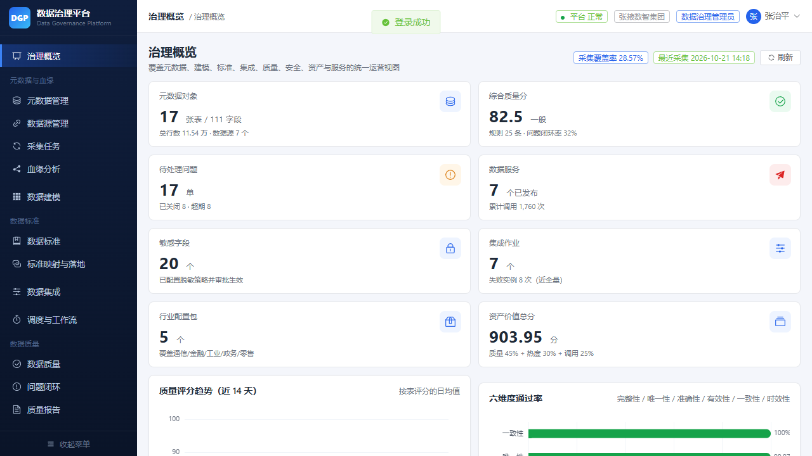
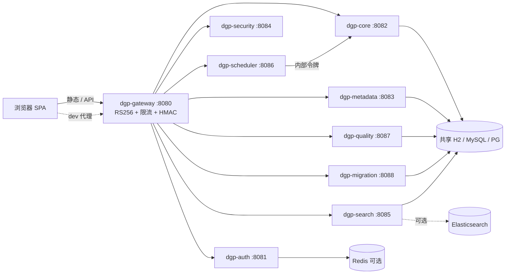

# DGP · 企业级数据治理平台

> 一个可直接跑起来的数据治理平台完整实现：元数据采集与血缘、统一建模、数据标准、图形化 ETL、六维质量稽核、分级分类与动态脱敏、数据服务开放网关、资产地图、报告与行业适配。
>
> 后端 **Spring Boot 3 / Spring Cloud Gateway** 多模块微服务 + 前端 Vue 3；本地默认共享 H2（`DGP_H2_FILE`），也可切 MySQL 8 / PostgreSQL。统一入口为网关 **8080**。



## 目录

- [核心能力](#核心能力)
- [技术栈](#技术栈)
- [系统架构](#系统架构)
- [目录结构](#目录结构)
- [快速开始](#快速开始)
- [演示账号](#演示账号)
- [接口与文档](#接口与文档)
- [质量保障（网关验收 + 业务断言）](#质量保障网关验收--业务断言)
- [性能数据](#性能数据)
- [部署（Linux / 生产向）](#部署linux--生产向)
- [已知限制与 Roadmap](#已知限制与-roadmap)
- [安全与免责声明](#安全与免责声明)

## 核心能力

| 模块 | 能力 |
|---|---|
| 治理概览 | 跨域 KPI、质量/调用趋势、待办聚合、行业上下文 |
| 元数据 | 数据源接入、采集任务与实例、库表字段检索、版本与变更、批量导入、血缘图谱、影响分析、SQL 血缘解析 |
| 数据建模 | 逻辑/物理模型、实体属性、发布审批（职责分离）、版本对比、DDL 预览与执行（幂等） |
| 数据标准 | 数据元全生命周期、标准映射推荐、批量落地、合规落地检查 |
| 数据集成 | 作业编排（DSL）、脚本发布校验、沙箱策略、SQL 校验/格式化、自助取数防越权、运行日志与实例 |
| 调度与工作流 | 工作流定义与实例、节点依赖执行；独立 `dgp-scheduler`（本地扫描 / 可选 XXL-Job） |
| 数据质量 | 六维规则库、规则试跑、全量/增量稽核、评分权重、评分回写、问题派单→处理→复核闭环、延期与超期 |
| 流式质检 | 水位窗口 + 微批校验（准实时）+ **实时事件推送接入**、超标自动告警、流源/规则/结果/告警管理 |
| 数据安全 | 敏感字段识别、脱敏策略审批与启停、动态脱敏预览、访问申请与授权、审计哈希链、导出与告警处置 |
| 数据资产 | 资产目录、搜索、详情与价值构成、资产地图、运营指标、分类树、收藏 |
| 数据服务 | 应用 AK/SK、API 上架审核发布、在线调试、开放网关（限流/配额/黑名单/OAuth2）、服务编排、调用指标 |
| 报告中心 | 多格式报告生成（HTML/CSV/MD）、任务查询、模板、下载头安全 |
| 数据迁移 | 字段映射（直接/表达式/常量/默认值）、自动推荐、预检与一键建表、分批/断点续传/失败回滚、行数/主键/空值/合计对账 |
| 跨网迁移 | **远程数据源（MySQL/PG）+ SOCKS5 / HTTP CONNECT 代理隧道**，远程↔本地跨库迁移；**FTP 文件迁移**（表→CSV/TXT→FTP 摆渡、SHA-256 校验） |
| 聚合汇总 | **聚合视图迁移向导**、**定时刷新作业**（FULL/UPSERT、失败提示、运行记录） |
| 安全与会话 | 登出吊销（Redis jti 可关）、refreshToken **一次性轮换 + 重放检测**；**多租户行级隔离**（`TenantGuard` 严格模式） |
| 行业适配 | 行业包预检/导入/实例化/启停、行业术语与血缘规则、实例差异 |
| 系统管理 | 用户/角色/权限/租户/组织/数据权限、字典、配置、操作与登录日志、健康与接口清单 |

## 技术栈

| 层级 | 选型 |
|---|---|
| 后端 | Java 17、Spring Boot 3.2、Spring Cloud Gateway、Nacos（可选）、`JdbcTemplate`（自研 `Db`）、HikariCP、Flyway（core） |
| 前端 | Vue 3.5、Vite 5、Element Plus、Pinia、Vue Router、ECharts 5 |
| 数据库 | H2（本地默认，多服务共享文件库）/ MySQL 8 / PostgreSQL |
| 认证鉴权 | JWT **RS256** + JWKS、网关验签与租户限流、HMAC 下游信任头、`@RequirePerm` |
| 安全能力 | AES-GCM 字段掩码、分级分类、审计哈希链（`dgp-security` 独立校验） |
| 检索 / 调度 | 统一检索（本地索引 / 可选 ES）、Outbox；本地到期扫描 / 可选 XXL-Job |
| 部署 | 多 jar + 网关；`deploy/compose`（Redis/Nacos/MySQL/Prometheus/Grafana 等） |

## 系统架构



| 服务 | 端口 | 路径 / 职责 |
|---|---|---|
| `dgp-gateway` | 8080 | 统一入口、验签、租户配额限流 |
| `dgp-auth` | 8081 | 登录 / 刷新 / 登出 / JWKS |
| `dgp-core` | 8082 | 过渡态业务域 + Flyway 种子（建模/标准/集成/资产等） |
| `dgp-metadata` | 8083 | `/api/v1/metadata/**` |
| `dgp-security` | 8084 | 审计链查询与校验 |
| `dgp-search` | 8085 | `/api/v1/search/**` |
| `dgp-scheduler` | 8086 | 到期扫描 / XXL 执行器 |
| `dgp-quality` | 8087 | `/api/v1/quality/**` |
| `dgp-migration` | 8088 | `/api/v1/migration/**` |

改造说明：[一期](docs/微服务改造-第一期.md) · [二期](docs/微服务改造-第二期.md) · [三期](docs/微服务改造-第三期.md) · [四期](docs/微服务改造-第四期.md) · [元数据](docs/微服务改造-元数据拆分.md) · [质量](docs/微服务改造-质量拆分.md) · [迁移](docs/微服务改造-迁移拆分.md)

## 目录结构

```
dataflow/
├── pom.xml                      # 多模块父工程
├── dgp-common/                  # 公共库：Result/Db/TenantGuard/HMAC 等
├── dgp-gateway/                 # API 网关 :8080
├── dgp-auth/                    # 认证 :8081
├── dgp-core/                    # 核心过渡服务 :8082（含静态资源与种子）
├── dgp-metadata/                # 元数据 :8083
├── dgp-security/                # 安全审计链 :8084
├── dgp-search/                  # 统一检索 :8085
├── dgp-scheduler/               # 调度 :8086
├── dgp-quality/                 # 质量 :8087
├── dgp-migration/               # 迁移 :8088
├── frontend/                    # Vue 3（dev 代理到网关 8080）
├── deploy/compose/              # Docker Compose（Redis/Nacos/应用等）
├── verify/                      # 网关冒烟 + 业务验收脚本
├── sql/                         # 数据库脚本
├── docs/                        # 改造/验收/运维文档
├── build.cmd                    # 前端构建 + 全模块 package
└── start-microservices.cmd      # 本地一键起服务
```

## 快速开始

### 方式一：微服务本地启动（推荐）

需要 **JDK 17** 与 **Maven 3.9+**。建议先起 Redis：

```bash
docker compose -f deploy/compose/docker-compose.yml up -d redis
```

```bat
REM Windows
build.cmd
start-microservices.cmd
```

或手动：

```bash
mvn -DskipTests package
# 再按 start-microservices.cmd 顺序启动各 jar
# core → auth → metadata → quality → migration → security → scheduler → search → gateway
```

打开 <http://127.0.0.1:8080>。冒烟：`verify\smoke_microservices.ps1`。

### 方式二：Compose 起基础设施 / 全栈

```bash
docker compose -f deploy/compose/docker-compose.yml up -d redis
# 可选：nacos / mysql / elasticsearch(profile es) / xxl-job-admin(profile xxl)
# 应用 jar 需先 mvn package，再按 compose 中各服务挂载 target/*.jar
```

### 方式三：MySQL 作为后台库

```bash
mysql -u root -p -e "CREATE DATABASE dgp DEFAULT CHARACTER SET utf8mb4 COLLATE utf8mb4_general_ci"
mysql -u root -p dgp < sql/schema-mysql.sql
mysql -u root -p dgp < sql/init-data-mysql.sql
```

各服务将数据源切到 MySQL（见各模块 `application-mysql.yml` / 环境变量），**仍经网关 8080 访问**。也可用 `python deploy/setup_mysql.py` 辅助建库。

### 方式四：前端开发模式（热更新）

```bash
cd frontend
npm install
npm run dev        # http://localhost:5173，/api 与 /open 代理到 127.0.0.1:8080
```

### 演示账号

| 账号 | 租户 | 角色 | 说明 |
|---|---|---|---|
| `admin` | 1 | 数据治理管理员 | 全权限（平台管理员，可看全部租户） |
| `dev_t1` | 1 | 数据开发工程师 | 采集/加工/建模/调度（租户 1 演示） |
| `quality_t1` | 1 | 数据质量专员 | 规则/稽核/问题闭环（租户 1 演示） |
| `analyst_t1` | 1 | 分析师（业务用户） | 检索/血缘/服务申请（租户 1 演示） |
| `secadmin` | 1 | 安全管理员 | 脱敏/审计/告警 |
| `consultant` | 1 | 行业实施顾问 | 行业包/标准映射/术语 |
| `zhangsan` | 2 | 数据开发工程师 | 租户 2（隔离后仅见本租户数据） |
| `liuqin` | 2 | 数据质量专员 | 租户 2 |
| `wangwu` | 3 | 分析师（业务用户） | 租户 3 |

演示口令统一为 `Dgp@2026`（仅用于本地/演示环境，生产必须修改）。

> **多租户演示说明**：种子数据属于**租户 1**；`zhangsan`/`liuqin`/`wangwu` 属于租户 2/3，开启行级隔离后登录这些账号列表为空（这是隔离生效的正确表现）。演示请使用 `dev_t1` / `quality_t1` / `analyst_t1`；`admin` 是平台管理员，保留全租户视角。

## 接口与文档

- 🗄️ **数据库脚本：[sql/README.md](sql/README.md)**
- 📚 **文档索引：[docs/README.md](docs/README.md)**
- ⭐ **验收报告：[docs/验收报告-全功能验证.md](docs/验收报告-全功能验证.md)**（单体时代 294 项口径；微服务请复跑网关套件）
- **REST 清单**：[docs/API清单.md](docs/API清单.md)（方法、路径、所需权限）
- 统一响应：`{ "code": 0, "message": "ok", "data": ..., "traceId": "..." }`；`403` 无权限、`401` 未认证/令牌失效
- 开放网关：`/open/v1/**`（AK/SK 或 OAuth2），经 `dgp-gateway` 转发
- 其他文档：
  - [微服务验收-网关冒烟](docs/微服务验收-网关冒烟.md)
  - [全功能截图版操作手册](docs/操作手册-全功能截图版.md)
  - [多租户与会话安全验收报告](docs/验收测试报告-多租户与会话安全-20261024.md)
  - [流式质检与数据迁移](docs/功能-流式质检与数据迁移.md)
  - [FTP 文件迁移与跨网迁移](docs/功能-FTP与跨网迁移.md)
  - [大数据量迁移基准](docs/大数据量迁移基准.md)
  - [开发与运维手册](docs/开发与运维手册.md)（部分章节仍写单体路径，以本 README 与微服务改造文档为准）
  - [并发容量报告](docs/并发容量报告.md)

## 质量保障（网关验收 + 业务断言）

微服务形态下 **`-Base` 一律指向网关 `http://127.0.0.1:8080`**（见 [微服务验收-网关冒烟](docs/微服务验收-网关冒烟.md)）：

```powershell
.\verify\smoke_microservices.ps1 -Base http://127.0.0.1:8080   # 健康、RS256/JWKS、metadata/quality/migration 等路由
.\verify\run_gateway_suite.ps1 -Base http://127.0.0.1:8080     # 冒烟 + verify.ps1
.\verify.ps1 -Base http://127.0.0.1:8080                       # 业务冒烟
.\verify\api_matrix.ps1 -Base http://127.0.0.1:8080            # 鉴权矩阵
.\verify\flows_core.ps1 -Base http://127.0.0.1:8080            # 认证/RBAC/元数据/建模/标准
.\verify\flows_ext.ps1  -Base http://127.0.0.1:8080            # 集成/调度/质量/安全
.\verify\flows_rest.ps1 -Base http://127.0.0.1:8080            # 资产/服务/报告/行业/系统
.\verify\flows_features.ps1 -Base http://127.0.0.1:8080        # 流式质检/迁移映射
.\verify\flows_tenant.ps1 -Base http://127.0.0.1:8080          # 多租户/会话安全
.\verify\flows_agg.ps1 -Base http://127.0.0.1:8080             # 聚合视图刷新
# 全量：.\verify\run_gateway_suite.ps1 -Full
```

跨网迁移 `flows_migration_v14.ps1` 仍依赖外部 DB/FTP/代理。

## 性能数据

1 vCPU / 2GB 单机实测（服务器本机 wrk 压测，排除公网 RTT；历史单体压测数据，微服务请按同样方法复测）：

| 场景 | 优化前 | 优化后 |
|---|---|---|
| 治理概览看板（单请求 30 条 SQL） | 17 QPS | **2324 QPS**（聚合 TTL 缓存） |
| 元数据列表 | 212 QPS | 307 QPS |
| 静态资源 1.3MB JS | 45 QPS | **2804 QPS**（nginx + gzip_static） |
| 鉴权开销 | 3 次查库/请求 | **0 次**（鉴权缓存 + 黑名单） |
| 流式质检概览（4C8G，c=200） | 279 QPS | **11,322 QPS** |
| 数据迁移概览（4C8G，c=200） | 862 QPS | **21,532 QPS** |
| 同库迁移（4C8G，500 万行） | — | **19.2 万行/s** |
| 跨库迁移（4C8G，500 万行） | — | **8.9 万行/s** |
| FTP 导入（4C8G，500 万行） | — | **10.1 万行/s** |

详见 [并发容量报告](docs/并发容量报告.md)、[VM 测试部署清单](docs/VM测试部署清单.md)。

## 部署（Linux / 生产向）

当前推荐：**先 `mvn -DskipTests package`，再 Compose 或分别托管各服务 jar**，入口只暴露网关。

```bash
mvn -DskipTests package
docker compose -f deploy/compose/docker-compose.yml up -d redis nacos
# 按 compose 挂载 dgp-*/target/*.jar 启动；或自行 systemd 托管各服务
```

生产必改环境变量（示例）：

- `DGP_GATEWAY_HMAC_SECRET`、`DGP_JWT_PRIVATE_KEY` / `DGP_JWT_PUBLIC_KEY`
- `DGP_MASK_KEY`、`DGP_SCHEDULER_TOKEN`、`DGP_CORS_ORIGINS`
- `DGP_REDIS_ENABLED=true` + `DGP_REDIS_HOST`
- `DGP_LOCAL_SCHEDULER=false`（生产关闭 core 内置调度）
- 可选：`DGP_NACOS_ENABLED`、`DGP_ES_ENABLED`、`DGP_XXL_ENABLED`

历史单 jar 远程脚本（`deploy/remote.py` 等）仍可能引用旧的 `backend/target/dgp-boot.jar`，新环境请优先 Compose / 多服务部署。H2 本地数据目录为仓库根下 `data/`；MySQL 用 `mysqldump --single-transaction dgp`。

## 报告与文档发布

验收/压测报告放在 `docs/`。可用：

```bash
python deploy/publish_docs.py "docs: 新增 XX 报告"
python deploy/publish_docs.py --dry-run
```

## 已知限制与 Roadmap

**已落地（相对旧 Roadmap）：** 多租户行级隔离（`TenantGuard`）、Flyway（core）、独立 scheduler + 可选 XXL-Job、统一检索 + 可选 ES、Compose 编排、元数据/质量/迁移绞杀拆分。

**仍待加强：**

- core 内仍有资产/标准/工作流/集成/CDC/模型等未拆服务；库仍多为共享库而非按域分库
- FTP 明文，跨公网建议 SFTP/FTPS
- 可观测性（Prometheus 已挂，生产告警/SLO 待完善）
- 部分运维/操作手册仍描述单体路径，需持续对齐

## 需求文档

需求基线见 [软件需求规格说明书.md](软件需求规格说明书.md)（编写时偏单体交付；实现以本 README 为准）。

## 安全与免责声明

- 演示账号与口令仅用于本地/内网演示，**生产必须改口令、换密钥、限制来源并启用 HTTPS**。
- 密钥经环境变量注入，仓库不含生产凭据。
- 本项目未附带开源许可证（默认保留所有权利）；商用或二次分发请先联系作者。

---

如果这个项目对你有帮助，欢迎 Star ⭐；有问题请提 Issue。
