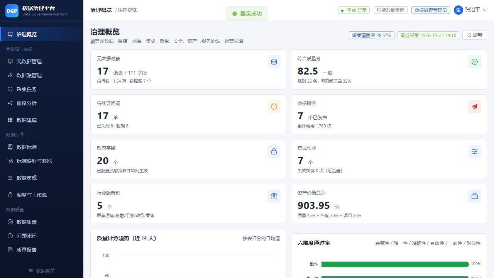
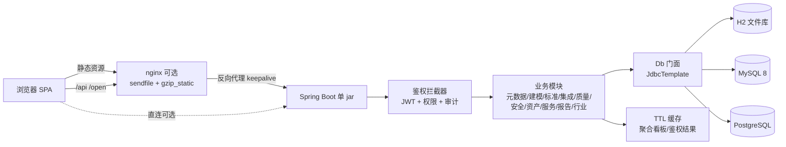

# DGP · 企业级数据治理平台

> 一个可直接跑起来的数据治理平台完整实现：元数据采集与血缘、统一建模、数据标准、图形化 ETL、六维质量稽核、分级分类与动态脱敏、数据服务开放网关、资产地图、报告与行业适配。
>
> 后端 Spring Boot 3 + 前端 Vue 3 全栈自研，单个 jar 同时托管 API 与前端，默认 H2 零依赖启动，也支持 MySQL 8 / PostgreSQL。



## 目录

- [核心能力](#核心能力)
- [技术栈](#技术栈)
- [系统架构](#系统架构)
- [目录结构](#目录结构)
- [快速开始](#快速开始)
- [演示账号](#演示账号)
- [接口与文档](#接口与文档)
- [质量保障（294 项断言）](#质量保障294-项断言)
- [性能数据](#性能数据)
- [部署（Linux / 生产向）](#部署linux--生产向)
- [已知限制与 Roadmap](#已知限制与-roadmap)
- [安全与免责声明](#安全与免责声明)

## 核心能力

| 模块 | 能力 |
|---|---|
| 治理概览 | 跨域 KPI、质量/调用趋势、待办聚合、行业上下文 |
| 元数据 | 数据源接入、采集任务与实例、库表字段检索、版本与变更、批量导入、血缘图谱、影响分析、SQL 血缘解析 |
| 数据建模 | 逻辑/物理模型、实体属性、发布审批（职责分离）、版本对比、DDL 预览与执行（幂等） |
| 数据标准 | 数据元全生命周期、标准映射推荐、批量落地、合规落地检查 |
| 数据集成 | 作业编排（DSL）、脚本发布校验、沙箱策略、SQL 校验/格式化、自助取数防越权、运行日志与实例 |
| 调度与工作流 | 工作流定义与实例、节点依赖执行、重试/终止、调度能力如实标注 |
| 数据质量 | 六维规则库、规则试跑、全量/增量稽核、评分权重、评分回写、问题派单→处理→复核闭环、延期与超期 |
| 流式质检 | 水位窗口 + 微批校验（准实时）+ **实时事件推送接入**（Kafka/HTTP 生产者可直接推送）、超标自动告警、流源/规则/结果/告警管理 |
| 数据安全 | 敏感字段识别、脱敏策略审批与启停、动态脱敏预览、访问申请与授权、审计哈希链、导出与告警处置 |
| 数据资产 | 资产目录、搜索、详情与价值构成、资产地图、运营指标、分类树、收藏 |
| 数据服务 | 应用 AK/SK、API 上架审核发布、在线调试、开放网关（限流/配额/黑名单/OAuth2）、服务编排、调用指标 |
| 报告中心 | 多格式报告生成（HTML/CSV/MD）、任务查询、模板、下载头安全 |
| 数据迁移 | 字段映射（直接/表达式/常量/默认值）、自动推荐、预检与一键建表、分批/断点续传/失败回滚、行数/主键/空值/合计对账 |
| 跨网迁移 | **远程数据源（MySQL/PG）+ SOCKS5 / HTTP CONNECT 代理隧道**，远程↔本地跨库迁移；**FTP 文件迁移**（表→CSV→FTP 摆渡、SHA-256 校验） |
| 行业适配 | 行业包预检/导入/实例化/启停、行业术语与血缘规则、实例差异 |
| 系统管理 | 用户/角色/权限/租户/组织/数据权限、字典、配置、操作与登录日志、健康与接口清单 |

## 技术栈

| 层级 | 选型 |
|---|---|
| 后端 | Java 17、Spring Boot 3.2、Spring MVC、`JdbcTemplate`（自研轻量 `Db` 门面）、HikariCP |
| 前端 | Vue 3.5、Vite 5、Element Plus、Pinia、Vue Router、ECharts 5 |
| 数据库 | H2（默认，文件库，零外部依赖）/ MySQL 8 / PostgreSQL（prod profile） |
| 认证鉴权 | JWT HS256（access/refresh，jti 黑名单）、PBKDF2-HMAC-SHA256（210k 迭代）、`@RequirePerm` 细粒度权限 |
| 安全能力 | AES-GCM 字段掩码、分级分类、审计哈希链（SHA-256 前后链） |
| 部署 | 单 jar 一体化（systemd）、可选 nginx 反代与静态资源托管 |

## 系统架构



## 目录结构

```
datagov/
├── backend/                     # Spring Boot 后端（含构建后的前端静态资源）
│   └── src/main/
│       ├── java/com/dgp/        # 按业务域分包：admin/auth/metadata/model/standard/
│       │                        # integration/workflow/quality/security/asset/service/
│       │                        # report/industry/seed/common
│       └── resources/
│           ├── application.yml          # 默认 H2
│           ├── application-mysql.yml    # MySQL profile
│           ├── application-prod.yml     # PostgreSQL profile
│           ├── schema.sql               # H2/PG DDL（77 张表）
│           └── schema-mysql.sql         # MySQL DDL（脚本生成，勿手改）
├── frontend/                    # Vue 3 单页前端（构建产物输出到 backend static）
├── deploy/                      # 部署与运维脚本（SSH/MySQL/nginx，凭据走环境变量）
├── verify/                      # 接口鉴权矩阵 + 业务链路验收脚本
├── sql/                         # 数据库脚本（MySQL 结构+初始化数据、H2/PG 结构）
├── docs/                        # API 清单、验收报告、并发容量报告、开发运维手册、截图
└── verify.ps1                   # 冒烟回归（73 项断言）
```

## 快速开始

### 方式一：默认 H2，一条命令起服务（推荐首次体验）

需要 **JDK 17** 与 **Maven 3.9+**：

```bash
cd backend
mvn -DskipTests clean package          # 首次会编译前端产物打包进 jar（仓库已内置构建结果）
java -jar target/dgp-boot.jar          # 默认 8080 端口，H2 文件库自动建表并装载演示数据
```

打开 <http://localhost:8080> 即可（首次启动会自动建 77 张表并写入 11 万+ 行演示数据，约 20~60 秒）。

### 方式二：MySQL 8 作为后台库

**A. 直接导入仓库内的 SQL 脚本（无需运行应用建库）**

```bash
mysql -u root -p -e "CREATE DATABASE dgp DEFAULT CHARACTER SET utf8mb4 COLLATE utf8mb4_general_ci"
mysql -u root -p dgp < sql/schema-mysql.sql       # 90 张表结构
mysql -u root -p dgp < sql/init-data-mysql.sql    # 配置/主数据初始化（含演示账号，不含演示明细）
```

**B. 或用部署脚本自动建库并校验 DDL**

```bash
export DGP_SSH_HOST=127.0.0.1 DGP_SSH_USER=root DGP_SSH_PASS=***
python deploy/setup_mysql.py

# 2) 用 mysql profile 启动
export DGP_DB_HOST=127.0.0.1 DGP_DB_NAME=dgp DGP_DB_USER=dgp DGP_DB_PASSWORD=***
java -jar backend/target/dgp-boot.jar --spring.profiles.active=mysql
```

DDL 由 `deploy/gen_mysql_schema.py` 从 `schema.sql` 生成（`IDENTITY→AUTO_INCREMENT`、索引内联、`TIMESTAMP→DATETIME`），可重复执行。

### 方式三：前端开发模式（热更新）

```bash
cd frontend
npm install
npm run dev        # http://localhost:5173，/api 与 /open 自动代理到 127.0.0.1:8080
```

### 演示账号

| 账号 | 角色 | 说明 |
|---|---|---|
| `admin` | 数据治理管理员 | 全权限 |
| `zhangsan` | 数据开发工程师 | 采集/加工/建模/调度 |
| `liuqin` | 数据质量专员 | 规则/稽核/问题闭环 |
| `wangwu` | 分析师（业务用户） | 检索/血缘/服务申请 |
| `secadmin` | 安全管理员 | 脱敏/审计/告警 |
| `consultant` | 行业实施顾问 | 行业包/标准映射/术语 |

演示口令统一为 `Dgp@2026`（仅用于本地/演示环境，生产必须修改）。

## 接口与文档

- 🗄️ **数据库脚本：[sql/README.md](sql/README.md)**（MySQL 结构 + 初始化数据 + H2/PG 结构）
- 📚 **文档索引：[docs/README.md](docs/README.md)**
- ⭐ **验收报告：[docs/验收报告-全功能验证.md](docs/验收报告-全功能验证.md)**（294 项断言全部通过）
- **320 个 REST 接口**，完整清单见 [docs/API清单.md](docs/API清单.md)（含方法、路径、所需权限）。
- 统一响应：`{ "code": 0, "message": "ok", "data": ..., "traceId": "..." }`；`403` 为无权限、`401` 为未认证/令牌失效。
- 开放网关：`/open/v1/**`（AK/SK 或 OAuth2 令牌），支持限流、配额、黑名单与字段脱敏。
- 其他文档：
  - [流式质检与数据迁移](docs/功能-流式质检与数据迁移.md)：流式质检与同库迁移的定位、模型、接口与使用
- [FTP 文件迁移与跨网迁移](docs/功能-FTP与跨网迁移.md)：远程数据源/代理隧道、FTP 摆渡、验证环境与限制
- [开发与运维手册](docs/开发与运维手册.md)：模块说明、库表、配置项、已知实现细节、排障
  - [全功能验收报告](docs/验收报告-全功能验证.md)：294 项断言口径与结果
  - [并发容量报告](docs/并发容量报告.md)：压测方法与优化前后数据

## 质量保障（373 项断言）

仓库自带可复跑的验收脚本，覆盖「接口鉴权矩阵 + 13 个业务域链路 + 跨角色一致性」：

```powershell
.\verify.ps1 -Base http://127.0.0.1:8080                 # 冒烟回归 73 项
.\verify\api_matrix.ps1 -Base http://127.0.0.1:8080      # 123 个 GET × 6 角色鉴权矩阵
.\verify\flows_core.ps1 -Base http://127.0.0.1:8080      # 认证/RBAC/元数据/建模/标准 70 项
.\verify\flows_ext.ps1  -Base http://127.0.0.1:8080      # 集成/调度/质量/安全 70 项
.\verify\flows_rest.ps1 -Base http://127.0.0.1:8080      # 资产/服务/报告/行业/系统/一致性 81 项
```

当前结果：**全部通过（73 + 70 + 70 + 81 + 55 + 24 = 373）**，鉴权矩阵 738 次请求 **0 个 5xx、0 越权/漏权**。脚本会真实创建→校验状态机→清理探针数据。

## 性能数据

1 vCPU / 2GB 单机实测（服务器本机 wrk 压测，排除公网 RTT）：

| 场景 | 优化前 | 优化后 |
|---|---|---|
| 治理概览看板（单请求 30 条 SQL） | 17 QPS | **2324 QPS**（聚合 TTL 缓存） |
| 元数据列表 | 212 QPS | 307 QPS |
| 静态资源 1.3MB JS | 45 QPS | **2804 QPS**（nginx + gzip_static） |
| 鉴权开销 | 3 次查库/请求 | **0 次**（鉴权缓存 + 黑名单内存化） |
| 流式质检概览（4C8G，c=200） | 279 QPS | **11,322 QPS**（GROUP BY 合并 + 5s 缓存） |
| 数据迁移概览（4C8G，c=200） | 862 QPS | **21,532 QPS**（5s 缓存） |

调优要点与扩容建议见 [并发容量报告](docs/并发容量报告.md)；4C8G 测试机的完整部署与压测步骤见 [VM 测试部署清单](docs/VM测试部署清单.md)。

## 部署（Linux / 生产向）

> 新虚拟机从零开始：在机器上执行 sudo bash deploy/vm_bootstrap.sh（装 JDK17/MySQL8/nginx/压测工具 + 建库导数据），再从开发机用 deploy/remote.py 推送 jar。完整步骤见 [VM 测试部署清单](docs/VM测试部署清单.md)。

```bash
# 1) 构建（跳过测试；前端产物已在仓库内，如需重建：cd frontend && npm run build）
cd backend && mvn -DskipTests clean package

# 2) 推送并托管为 systemd 服务（凭据只经环境变量传入）
export DGP_SSH_HOST=<server-ip> DGP_SSH_PORT=22 DGP_SSH_USER=root DGP_SSH_PASS=***
export DGP_JWT_SECRET=<32+ 位随机串> DGP_MASK_KEY=<32+ 位随机串>
python deploy/remote.py deploy backend/target/dgp-boot.jar 8092

# 3) 可选：MySQL 后台库
export DGP_DB_PASSWORD=***; python deploy/setup_mysql.py
python deploy/remote.py deploy backend/target/dgp-boot.jar 8092   # 检测到 DGP_DB_PASSWORD 自动启用 mysql profile

# 4) 可选：nginx 托管前端静态资源 + 反代 API（独立端口，不影响机器上已有站点）
export DGP_NGINX_PORT=8093; python deploy/nginx_setup.py
```

- 生产必须注入 `DGP_JWT_SECRET` / `DGP_MASK_KEY`（缺失会拒绝启动），并按需设置 `DGP_CORS_ORIGINS`。
- `deploy/remote.py` 支持 `probe / deploy / status / logs / restart / stop` 子命令。
- 数据备份：H2 备份 `backend/data`；MySQL 用 `mysqldump --single-transaction dgp`。

## 报告与文档发布

验收/压测/测试报告统一放在 `docs/` 下，并保留在仓库中。新增或更新报告后，一条命令即可发布：

```bash
python deploy/publish_docs.py "docs: 新增 XX 报告"
python deploy/publish_docs.py --dry-run    # 先看哪些文件有差异
```

脚本优先 `git push`（3 次重试）；当 `github.com:443` 不可达时会自动降级为 **GitHub REST API** 直连 `api.github.com` 提交（只上传内容有差异的文件），因此报告不会因为网络问题漏推。凭据复用本机 git 凭据管理器，不落盘、不打印。

## 已知限制与 Roadmap

- 多租户目前做到「字段 + 菜单/数据权限」隔离，**行级 SQL 自动注入**尚未实现（Roadmap 第一项）。
- 流式质检为「水位窗口 + 微批 + 实时推送入口」实现，Kafka/Flink 等通过 HTTP 推送接入。
- 跨网迁移：已支持远程 MySQL/PostgreSQL（直连/SOCKS5/HTTP 代理）与 FTP 文件摆渡；FTP 为明文，跨公网建议 SFTP/FTPS（Roadmap）。
- 调度为进程内 Scheduler（支持固定分钟/小时表达式），未接外部调度系统（Airflow/XXL-Job）。
- 未内置 Elasticsearch / 图数据库 / Kafka：全量检索与血缘图基于关系库实现，数据量大时建议替换。
- 数据库变更未引入 Flyway，采用幂等 DDL + 启动种子（版本化迁移在 Roadmap 中）。
- Roadmap：多租户行级隔离、Flyway 迁移、ES 检索、图库血缘、可观测性（Micrometer/Prometheus）、Docker Compose 一键起。

## 需求文档

系统的需求基线见 [软件需求规格说明书.md](软件需求规格说明书.md)（基于当前实际实现编写）。

## 安全与免责声明

- 演示账号与演示口令仅用于本地/内网体验，**生产环境必须修改口令、更换密钥、限制来源 IP 并启用 HTTPS**。
- 代码中所有密钥均通过环境变量注入，仓库不包含生产凭据。
- 本项目未附带开源许可证（默认保留所有权利）；如需商用或二次分发，请先与作者联系。

---

如果这个项目对你有帮助，欢迎 Star ⭐；有问题请提 Issue。
