# DGP 数据治理平台 · 操作手册

> 适用范围：DGP v1.4.2（含流式质检、数据迁移、FTP/跨网迁移）
> 文档版本：v1.0　编写日期：2026-10-22
> 读者对象：数据治理管理员、数据开发、数据质量专员、数据分析师、安全管理员、平台运维

---

## 目录

- [1. 平台简介与快速开始](#1-平台简介与快速开始)
- [2. 治理概览](#2-治理概览)
- [3. 元数据与血缘](#3-元数据与血缘)
- [4. 数据建模](#4-数据建模)
- [5. 数据标准](#5-数据标准)
- [6. 数据集成](#6-数据集成)
- [7. 调度与工作流](#7-调度与工作流)
- [8. 数据质量](#8-数据质量)
- [9. 数据安全](#9-数据安全)
- [10. 数据资产](#10-数据资产)
- [11. 数据服务](#11-数据服务)
- [12. 行业适配](#12-行业适配)
- [13. 数据迁移（含跨网络 / FTP）](#13-数据迁移含跨网络--ftp)
- [14. 系统管理](#14-系统管理)
- [15. 运维与部署](#15-运维与部署)
- [16. 典型场景演练](#16-典型场景演练)
- [17. 常见问题（FAQ）](#17-常见问题faq)
- [附录 A 角色与权限点](#附录-a-角色与权限点)
- [附录 B 验收、性能与文档索引](#附录-b-验收性能与文档索引)

---

## 1. 平台简介与快速开始

### 1.1 平台定位

DGP（Data Governance Platform）是企业级数据治理平台，覆盖 **元数据与血缘 → 数据建模 → 数据标准 → 数据集成 / 调度 → 数据质量 → 数据安全 → 数据资产 → 数据服务** 的端到端治理链路，并内置数据迁移、流式质检、行业适配等实施工具。

| 能力域 | 主要功能 |
|---|---|
| 元数据与血缘 | 数据源管理、元数据采集、表/字段资产、字段级血缘与影响分析 |
| 数据建模 | 逻辑/物理模型、模型画布、DDL 生成与执行、版本管理 |
| 数据标准 | 标准分类与码表、标准映射、落标稽核 |
| 数据集成 | 采集/加工作业编排、实例监控 |
| 调度与工作流 | 作业调度、工作流定义与触发、运行实例 |
| 数据质量 | 六维质量规则、试跑、稽核、评分、问题闭环、质量报告、**流式质检（微批 + 实时推送）** |
| 数据安全 | 敏感数据识别、分类分级、脱敏策略与审批、审计告警 |
| 数据资产 | 资产目录、资产价值评分、资产地图 |
| 数据服务 | API 发布、授权、调用统计、配额 |
| 数据迁移 | 同库/跨库迁移、字段映射推荐、预检、分批续传回滚、对账、**远程数据源 + 代理隧道**、**FTP 文件迁移（CSV/TXT）** |
| 行业适配 | 行业包导入/实例化、行业术语与领域差异 |
| 系统管理 | 用户/角色/权限、字典、运行参数、监控、接口清单、审计日志 |

### 1.2 访问与登录

浏览器访问平台地址（示例：`http://<部署主机>:8093`），输入账号、口令与验证码（如启用）后进入。

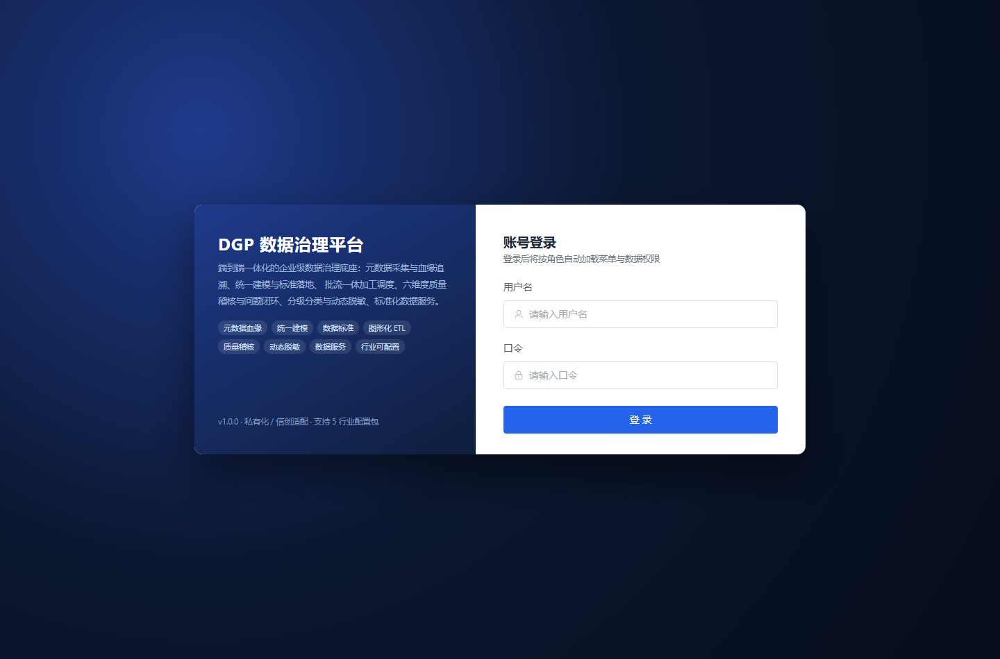

**演示账号**（初始口令 `Dgp@2026`，首次登录后请修改）：

| 账号 | 租户 | 角色 | 主要权限 |
|---|---|---|---|
| `admin` | 1 | 超级管理员 | 全部功能（平台管理员，全租户视角） |
| `dev_t1` | 1 | 数据开发 | 元数据、建模、集成、迁移、质量 |
| `quality_t1` | 1 | 数据质量专员 | 质量规则/稽核/问题/流式质检/报告 |
| `analyst_t1` | 1 | 数据分析师 | 元数据、资产、质量查看、报告（只读为主） |
| `secadmin` | 1 | 安全管理员 | 安全策略、审计、告警 |
| `consultant` | 1 | 行业顾问 | 行业包、迁移、标准 |
| `zhangsan` / `liuqin` | 2 | 开发 / 质量 | 仅本租户数据（演示数据在租户 1，登录后为空） |
| `wangwu` | 3 | 分析师 | 仅本租户数据 |

> 多租户提示：种子数据属于租户 1；`zhangsan`/`liuqin`/`wangwu` 属于租户 2/3，开启隔离后只能看到本租户数据，列表为空属正常。
>
> 登录失败请确认账号状态（锁定/停用）与口令；连续输错会触发登录限流（返回 429），稍后重试即可。

### 1.3 界面布局

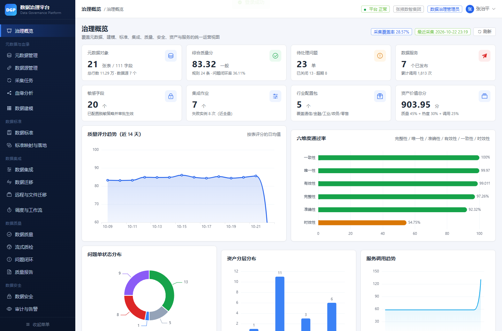

- **左侧导航**：按能力域分组，可折叠；菜单由后端按当前账号权限下发，无权限的菜单不显示。
- **顶部栏**：面包屑、平台健康状态、租户、当前角色、用户菜单（修改口令/退出登录）。
- **内容区**：查询条件、操作按钮、数据表格、分页；多数页面支持刷新、导出、批量操作。
- **通用约定**：列表默认分页 10/20/50 条；搜索支持关键字；危险操作（删除、回滚）有二次确认。

### 1.4 角色与权限矩阵

| 模块 | 管理员 | 数据开发 | 质量专员 | 分析师 | 安全管理员 | 行业顾问 |
|---|---|---|---|---|---|---|
| 概览/元数据/资产 | 全部 | 读写 | 只读 | 只读 | 只读 | 只读 |
| 建模/标准/集成/调度 | 全部 | 读写 | 只读 | 只读 | — | 只读 |
| 质量规则/稽核/问题闭环 | 全部 | 读写 | 读写 | 只读 | — | 只读 |
| 流式质检 | 全部 | 读写+执行 | 读写+执行 | 只读 | 只读 | 只读 |
| 安全策略/审计 | 全部 | 只读 | 只读 | — | 读写 | — |
| 数据迁移（项目/执行/回滚） | 全部 | 全部 | — | — | — | 全部 |
| 远程数据源 / FTP 任务 | 全部 | — | — | — | — | 全部 |
| 系统管理 | 全部 | — | — | — | 只读 | — |

> 精细权限点见 [附录 A](#附录-a-角色与权限点)。

---

## 2. 治理概览

### 2.1 页面组成

- **8 个指标卡**：元数据对象（表数/字段数/总行数/数据源数）、综合质量分（规则数/闭环率）、待处理问题（已关闭/超期）、数据服务（已发布/累计调用）、敏感字段（策略生效数）、集成作业（失败实例）、行业配置包、资产价值总分。
- **图表区**：质量评分趋势（近 14 天）、六维度通过率、问题单状态分布、资产分层分布、服务调用趋势。
- **右上角**：采集覆盖率、最近采集时间、刷新按钮。

### 2.2 操作

1. 点击 **刷新** 重新拉取指标与图表。
2. 点击任意指标卡/图表扇区可跳转到对应模块（如问题单、资产、服务）。
3. 综合质量分由「规则评分 + 问题闭环 + 时效」加权计算，评分权重可在系统管理 → 运行参数中调整。

> 页面数据 30 秒轮询刷新；切换菜单再返回会立即刷新。

---

## 3. 元数据与血缘

### 3.1 元数据管理

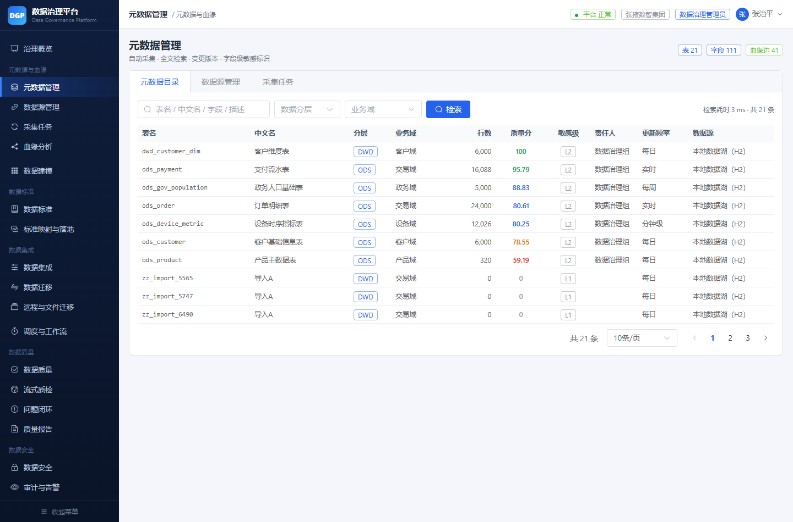

**列表字段**：表名、中文名、所属层（ODS/DWD/DWS/ADS）、域、行数、大小、负责人、最近 DDL 时间、采集状态。

**操作步骤**：

1. 顶部按关键字（表名/中文名）、层、域筛选，点击 **查询**。
2. 点击表名或 **详情** 打开表详情：基础信息、字段清单（含注释/类型）、数据样例、上下游血缘、质量规则、变更记录。

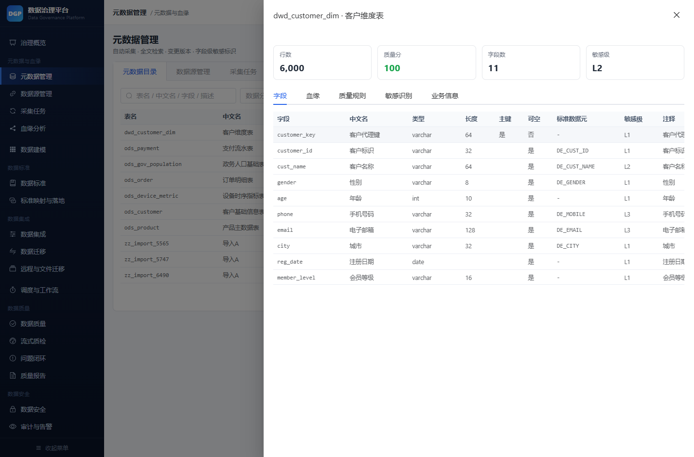

3. 表详情中可直接 **发起采集**、**添加质量规则**、**查看血缘**。
4. 支持导出当前列表为 CSV（右上角「导出」）。

> 表名是血缘、规则、脱敏策略的关联键，重命名表需走变更流程，避免断链。

### 3.2 数据源管理

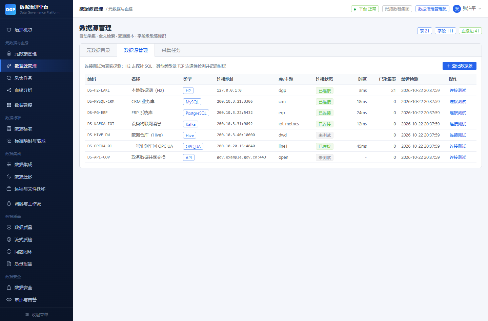

**新增数据源步骤**：

1. 点击 **新建数据源**，填写编码、名称、类型（MySQL/PostgreSQL/H2 等）、主机、端口、库名、账号、口令。
2. 点击 **测试连接**，确认返回成功与版本。
3. 保存后可点击 **采集** 拉取该库元数据；采集方式支持手动与定时（AUTO）。
4. 敏感字段（口令）加密存储，列表不显示明文。

### 3.3 采集任务

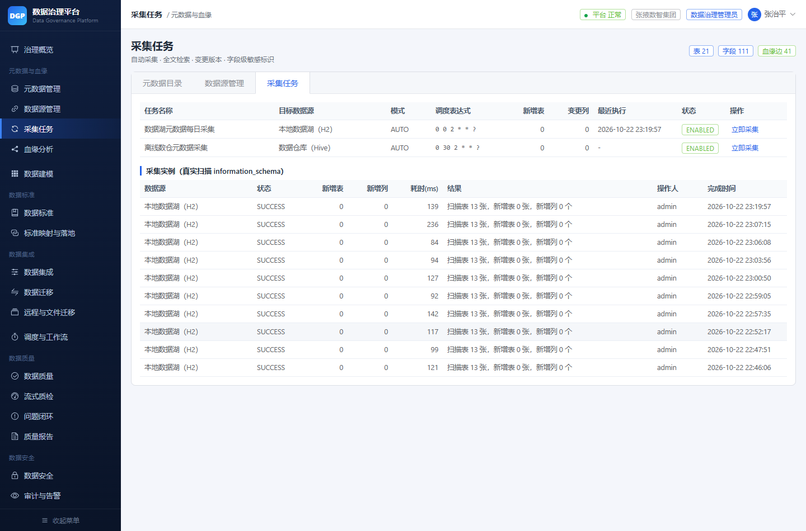

- **任务页签**：任务名称、数据源、模式（AUTO/MANUAL）、Cron、状态、下次运行时间；支持新建、编辑、立即执行。
- **实例页签**：每次采集的实例记录（开始/结束时间、表数量、成功/失败、错误信息），失败可查看原因并重试。

**操作**：立即执行 → 观察实例状态 → 完成后回元数据列表确认新表已登记。

### 3.4 血缘分析

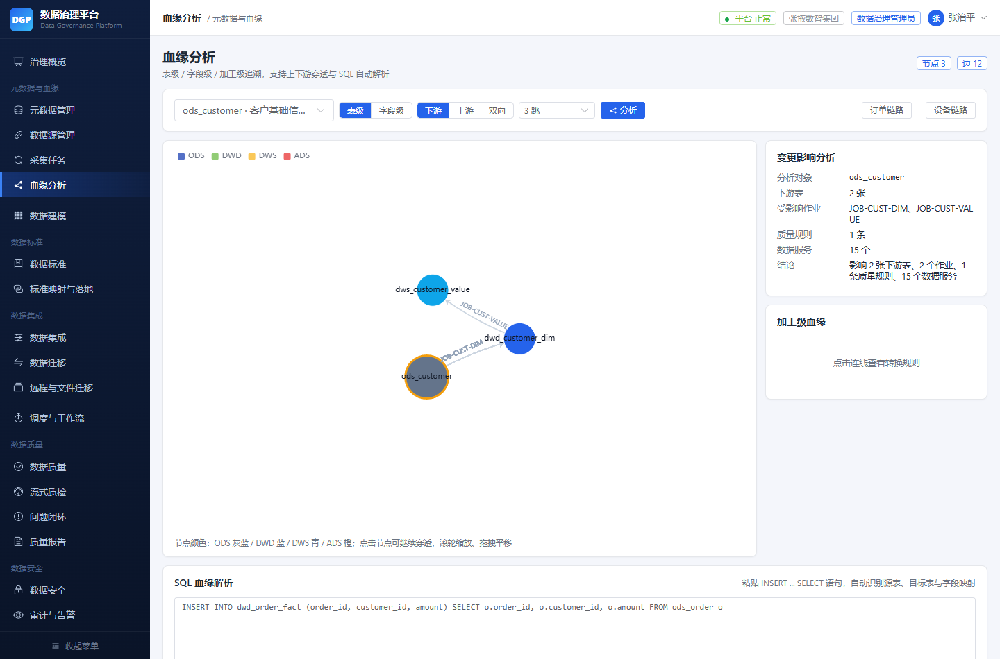

1. 搜索并选择一张表（或字段），选择层级深度（1~5 层）。
2. 图中：上游（左）→ 当前（中）→ 下游（右），节点可点击跳转表详情。
3. **影响分析**：选择某字段，查看下游受影响的表/任务/服务，便于变更评估。
4. 支持按作业解析的血缘与手工补录血缘；无法解析的 SQL 会在「解析失败」中给出原因。

---

## 4. 数据建模

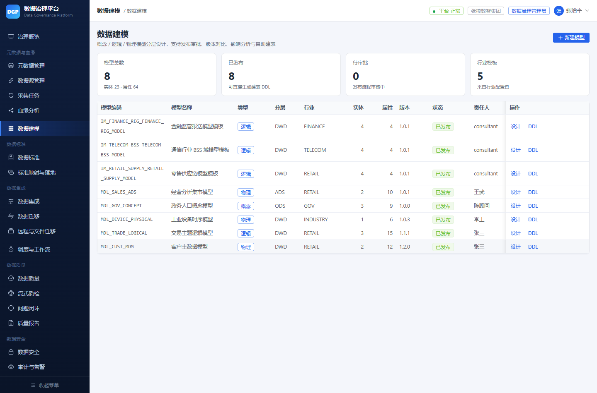

**功能**：逻辑模型/物理模型、模型画布（拖拽实体/关系）、字段与约束定义、DDL 生成与执行、模型发布与版本。

**典型操作**：

1. 新建模型 → 选择主题域/分层（如 DWD 层）。
2. 在画布中添加实体，双击编辑字段（名称/类型/主键/非空/注释）。
3. 点击 **生成 DDL** 预览建表语句，确认后 **执行** 到目标库（需 DDL 权限）。
4. 点击 **发布** 生成版本；后续变更生成新版本，可对比差异、回滚到历史版本。
5. 模型字段可关联数据标准，形成「标准 → 模型 → 物理表」链路。

---

## 5. 数据标准

### 5.1 标准管理

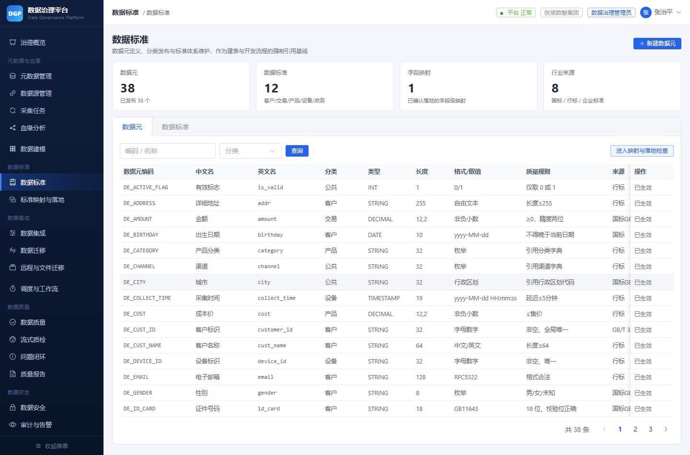

- **标准分类**：按业务域组织（客户、订单、产品等）。
- **数据元/码表**：标准编码、中文名、数据类型、长度、取值范围、码表引用。
- **操作**：新建标准 → 填写元数据 → 关联码表 → 发布；支持批量导入/导出。

### 5.2 标准映射与落地

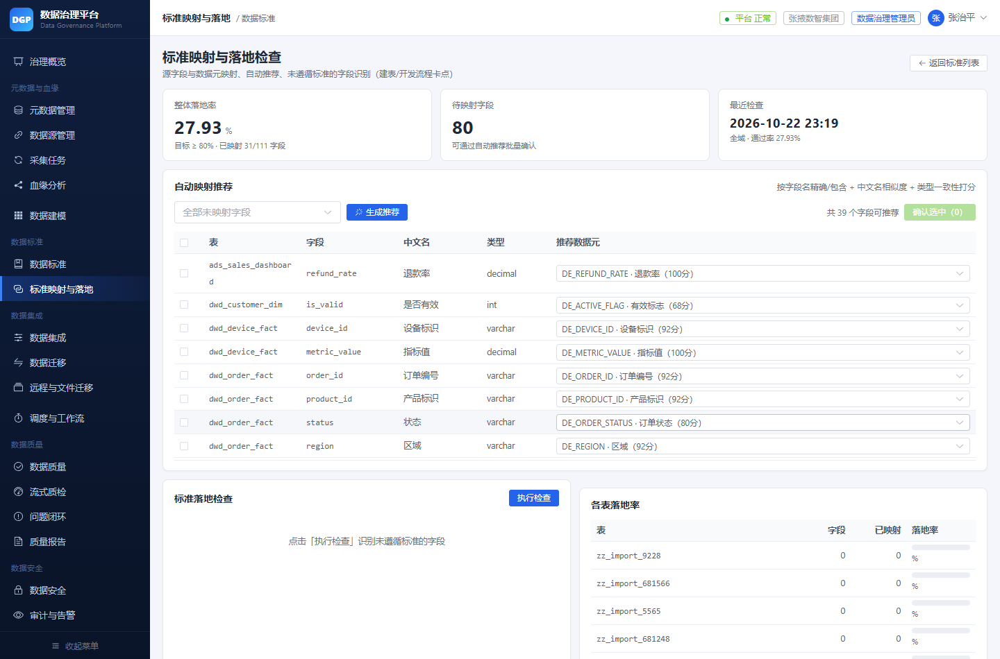

1. 选择标准与目标表字段，建立映射（一张表可映射多个标准）。
2. 保存后系统计算 **落标率**，并可按表/域查看未落标字段。
3. 对已映射字段可发起 **落标稽核**，生成符合/不符合清单。
4. 映射关系会同步到元数据详情与资产页，便于追溯。

---

## 6. 数据集成

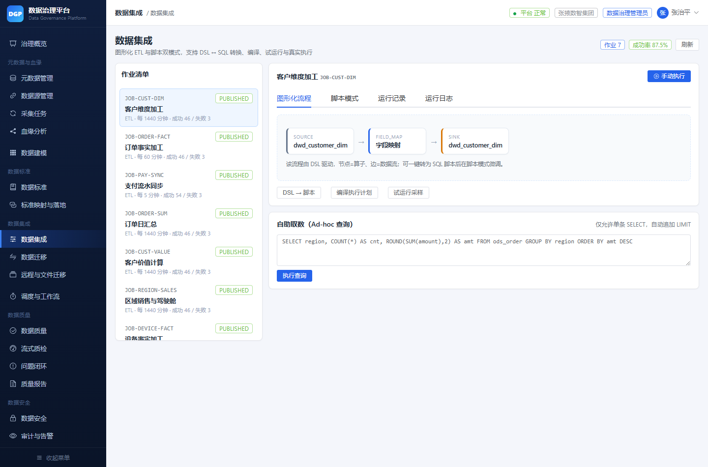

**功能**：数据采集/加工作业的编排与运行监控。

**操作步骤**：

1. 新建作业：选择作业类型（采集/同步/加工）、源与目标（表或 SQL）、字段映射、调度周期。
2. 保存后 **试运行**，查看输出行数与耗时。
3. 发布后由调度器按 Cron 执行；作业实例列表可查看每次运行状态、行数、错误日志。
4. 失败实例支持重跑/终止；连续失败可触发告警（审计与告警模块）。

---

## 7. 调度与工作流

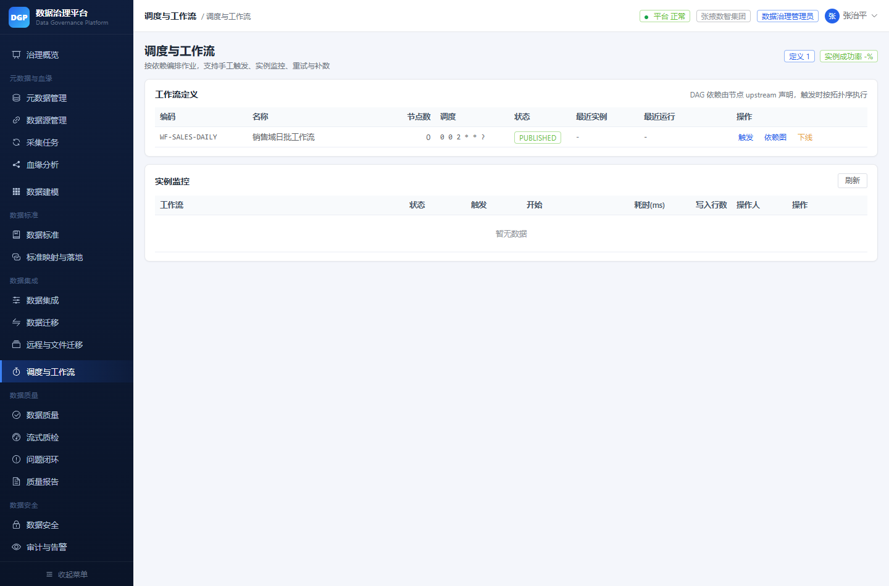

- **工作流定义**：节点（作业/人工审批/条件分支）+ 依赖关系，以 DSL 描述。
- **触发**：手动触发或按 Cron 调度；触发后生成运行实例。
- **实例监控**：节点级状态、耗时、日志；失败节点可重试。
- **调度同步状态**：展示与外部调度系统（如内置 Scheduler）的同步是否正常。

> 当前内置进程内调度器，支持分钟/小时级 Cron；未接外部调度系统（Airflow/XXL-Job）时，`syncStatus` 显示 unsupported 属正常。

---

## 8. 数据质量

### 8.1 质量规则与试跑

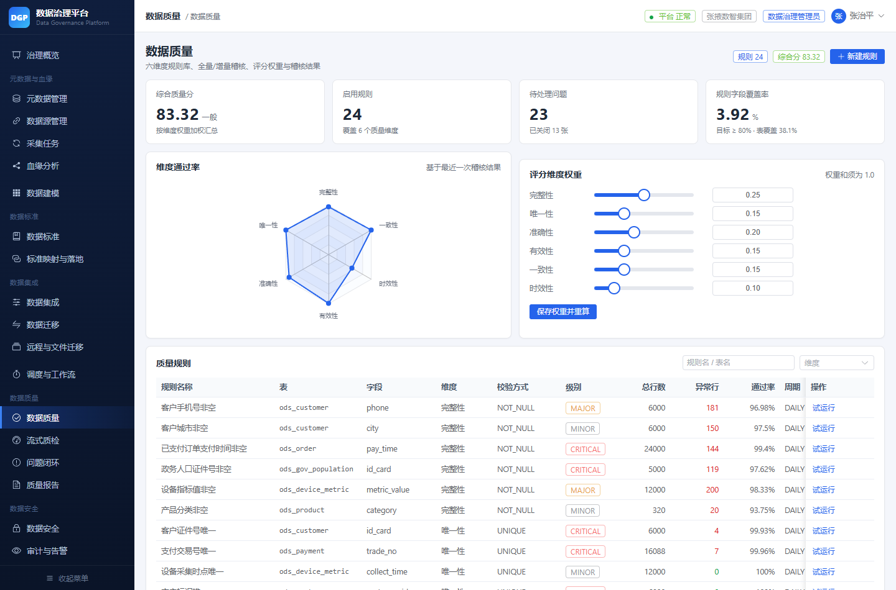

1. **新建规则**：选择表、维度（完整性/唯一性/准确性/有效性/一致性/时效性）、规则模板或自定义 SQL 断言、阈值、级别。
2. **试跑**：选择规则与样本量，查看通过率、失败行数、失败样例与耗时。
3. 保存后加入稽核任务；规则支持启停、复制、批量导入。

**六维说明**：

| 维度 | 典型规则 |
|---|---|
| 完整性 | 非空率、主键非空 |
| 唯一性 | 主键/业务键重复 |
| 准确性 | 金额范围、枚举值合法 |
| 有效性 | 日期格式、正则校验 |
| 一致性 | 跨表外键一致、汇总一致 |
| 时效性 | 数据延迟、未来时间 |

### 8.2 稽核任务与评分

- 新建稽核任务（全量/增量、抽样比例、调度），执行后生成 **稽核结果**（每规则通过率/失败数/状态）。
- **质量评分**：按维度权重、规则权重加权，结果回写资产与概览。
- **问题生成**：不达阈值的规则自动生成问题单（可配置是否自动派单）。

### 8.3 流式质检（微批 + 实时推送）

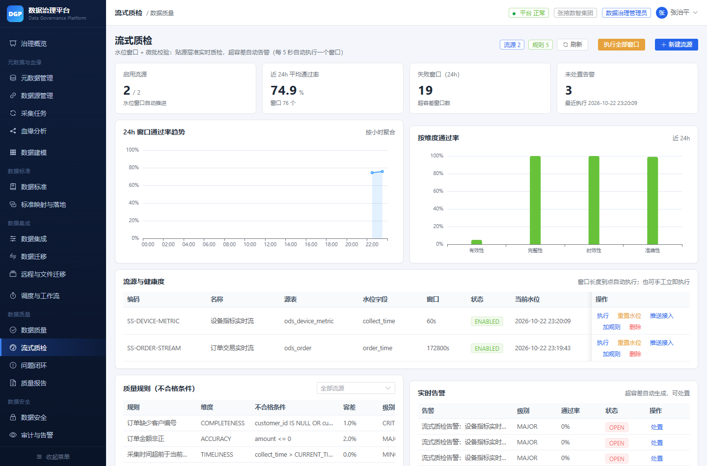

**适用场景**：贴源层准实时质检（设备指标、订单交易等）。

**操作步骤**：

1. 新建 **流源**：选择源表、水位字段（时间戳/自增）、窗口长度（如 60s）、批量上限。
2. 新建 **流式规则**：维度、**不合格条件**（布尔谓词，如 `metric_value < -100 OR metric_value > 200`）、容差（如 0.05 表示失败率 ≤5% 视为通过）、级别。
3. 系统每 5 秒自动执行一个窗口；页面展示实时 KPI、24h 趋势、按维度/按源健康度、窗口结果、告警。
4. 手工操作：**执行全部窗口**（补数）、**重置水位**（回溯）、告警 **处置**。
5. **实时推送接入**（Kafka/业务系统直连）：在流源行点击 **推送接入**，配置字段映射 JSON 并保存。

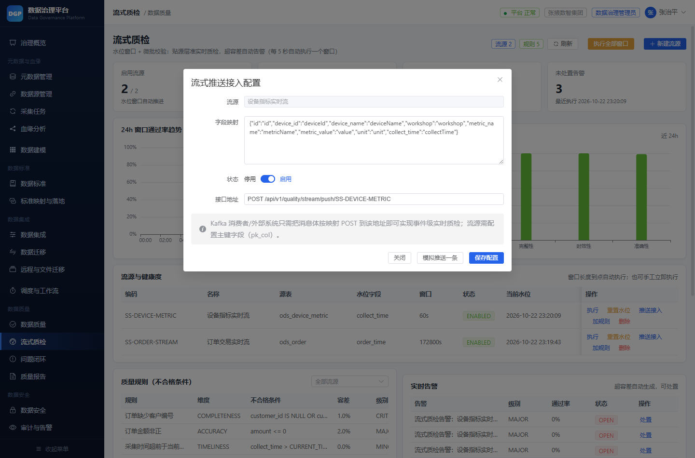

```bash
# 生产者示例：每条消息 POST 一次，平台落库并按规则即时判定
curl -X POST "http://<host>:8093/api/v1/quality/stream/push/SS-DEVICE-METRIC" \
  -H "Authorization: Bearer <token>" -H "Content-Type: application/json" \
  -d '{"id":900001,"deviceId":"DEV-01","deviceName":"1号设备","workshop":"A车间",
       "metricName":"温度","value":999.9,"unit":"℃","collectTime":"2026-10-22 23:00:00"}'
```

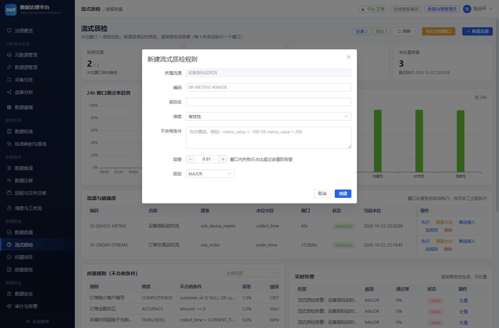

> 空窗口不推进水位，避免迟到数据被永久跳过；重置水位请谨慎，会影响窗口起点。

### 8.4 问题闭环

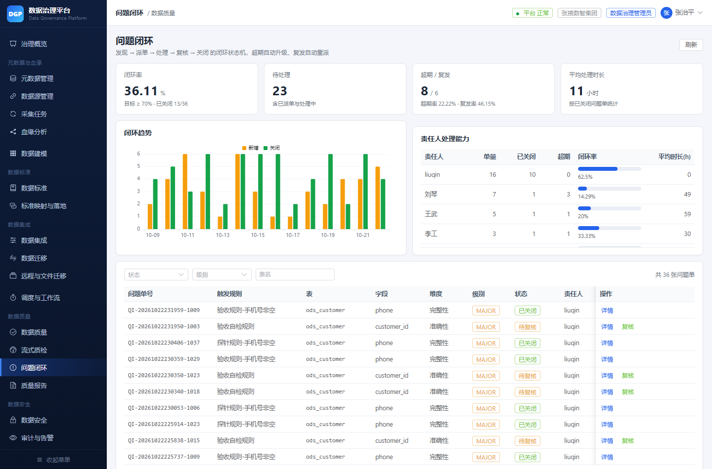

**流程**：发现 → 派单 → 处理中 → 复核 → 关闭（可延期/超期/忽略/复发）。

1. 在问题列表按状态、级别、责任人筛选。
2. 打开问题单查看失败样例、关联规则/表、处理记录。
3. 处理后填写处理说明并提交复核；复核通过后关闭。
4. 超期问题会标识并进入概览「超期」指标；复发问题可关联原问题。

### 8.5 质量报告

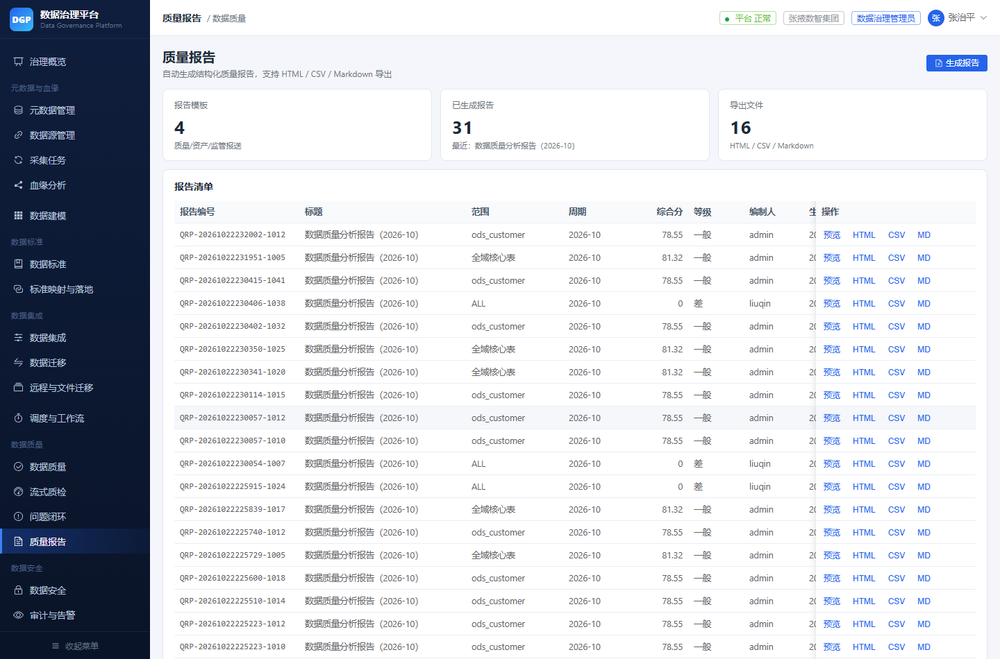

1. 选择报告类型（日报/周报/月报/专项）、范围（全域/指定域/指定表）。
2. 点击 **生成报告**，选择输出格式（HTML/CSV/Markdown），生成后可预览/下载。
3. 报告包含：质量总分、六维得分、TOP 问题、趋势、明细清单。

---

## 9. 数据安全

### 9.1 安全策略

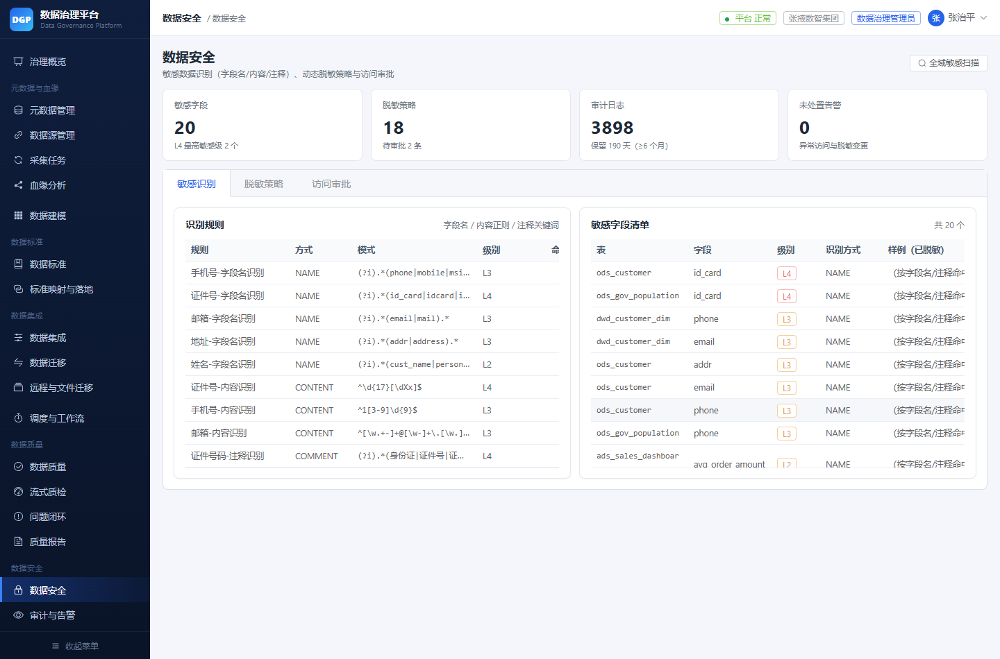

- **敏感识别**：按内置规则（身份证、手机号、邮箱、银行卡等）扫描字段，生成敏感字段清单与分级（L1~L5）。
- **分类分级**：维护数据分类与敏感等级映射。
- **脱敏策略**：选择算法（掩码 MASK、替换 REPLACE、截取 TRUNCATE、加密 ENCRYPT、散列 HASH、泛化 GENERALIZE）、作用范围、生效方式（查询/导出/服务）。
- **审批**：策略提交后走审批流，通过后生效；变更留痕。

### 9.2 审计与告警

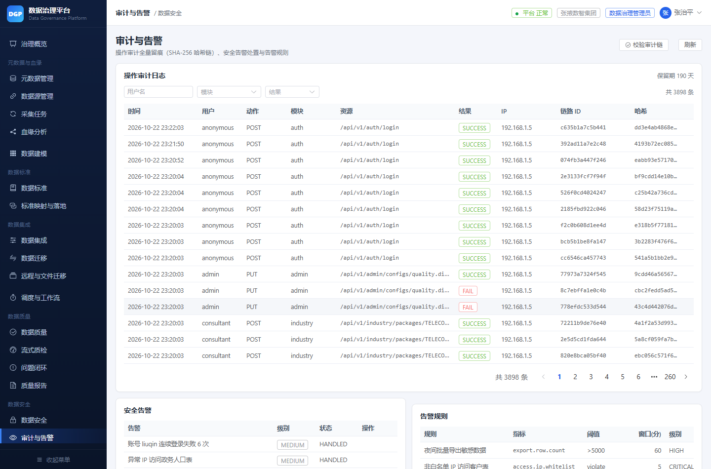

- **审计日志**：记录登录、增删改、导出、权限变更、策略操作等；支持按用户/动作/对象/时间检索。
- **告警**：异常登录、批量导出、敏感访问等规则触发的告警；可确认/关闭/转问题单。
- **导出**：审计日志支持导出，满足合规审计要求。

---

## 10. 数据资产

### 10.1 资产目录

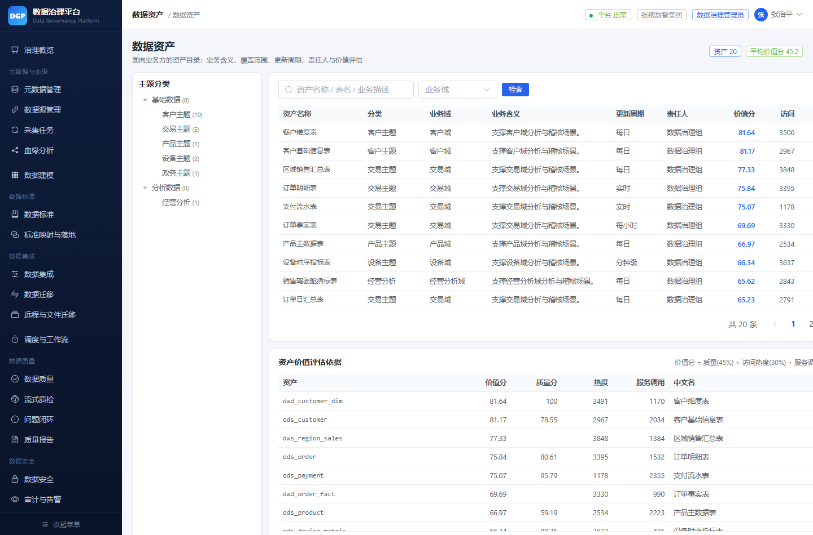

- 资产列表：资产名、类型（表/字段/API/报告）、所属域、分层、负责人、质量分、热度、价值分。
- 支持按域/层/标签筛选，收藏常用资产，查看资产详情（元数据 + 质量 + 血缘 + 服务）。
- **价值评分** = 质量权重 + 热度权重 + 调用权重（权重可配置）。

### 10.2 资产地图

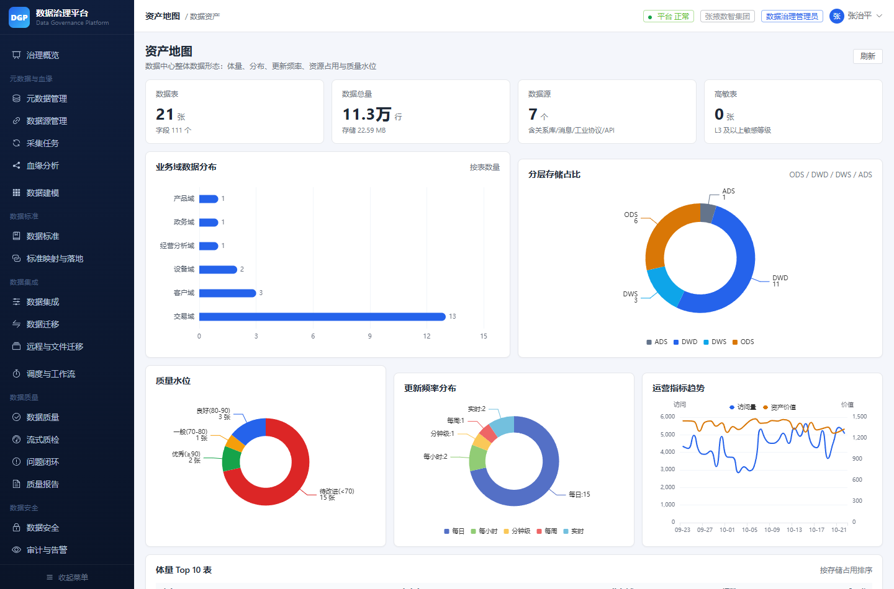

- 按主题域/分层展示资产分布与关系，支持缩放、筛选、点击下钻。
- 便于盘点「有哪些数据、在哪里、质量如何、被谁使用」。

---

## 11. 数据服务

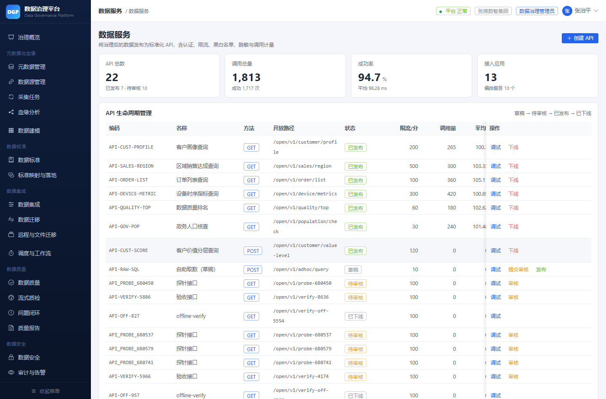

**功能**：把表/视图/SQL 封装为 REST API，对外提供受控数据服务。

**操作步骤**：

1. 新建 API：选择数据源与表/SQL，配置请求参数、返回字段、分页、限流（QPS）、鉴权方式（AK/SK 或令牌）。
2. **调试**：在页面内填写参数预览返回结果。
3. **发布**：发布后生成调用地址与 AK/SK；可绑定授权应用/租户。
4. **调用统计**：查看调用量、成功率、平均耗时、错误分布。
5. **配额与下线**：可设置每日调用配额；下线后调用返回「API 已下线」。

> 敏感字段会自动应用脱敏策略；服务调用记入审计日志。

---

## 12. 行业适配

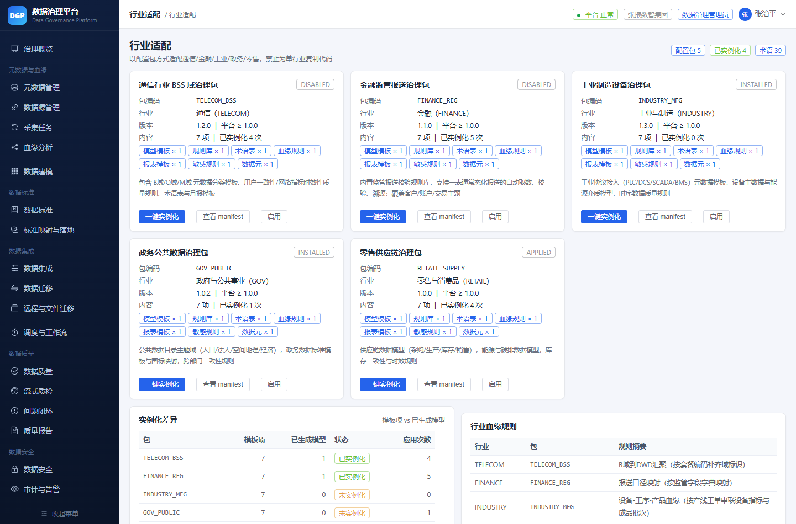

- **行业包**：内置通信/金融/工业/政务/零售等行业模板（标准、模型、规则、指标）。
- **预检**：检查包版本兼容性、依赖冲突、manifest 合法性。
- **导入/实例化**：把行业包实例化到当前租户，自动创建标准/模型/规则等对象。
- **启停与差异**：可对行业包启停；「实例差异」列出本地修改与包内容的差异，便于升级合并。

**操作步骤**：选择包 → 预检 → 导入 → 实例化 → 查看差异 → 按需调整。

---

## 13. 数据迁移（含跨网络 / FTP）

> 数据迁移是本平台的核心实施工具，支持 **同库表→表**、**跨实例/跨网络库→库**、**FTP 文件摆渡** 三种通道。

### 13.1 概念与能力

| 概念 | 说明 |
|---|---|
| 迁移项目 | 源表 → 目标表，模式 FULL（全量）/ INCREMENTAL（增量，按水位字段） |
| 字段映射 | 源字段 → 目标字段；转换类型 DIRECT（直取）/ EXPR（表达式）/ CONST（常量）/ DEFAULT（默认值） |
| 自动推荐 | 按字段名相似度 + 类型族自动匹配，类型不一致时自动生成 `CAST(...)` |
| 预检 | 校验源字段/目标列是否存在、类型风险、转换后样例、建议建表 DDL |
| 一键建表 | 目标表不存在时按映射生成并执行 DDL |
| 执行 | 同库用 `INSERT … SELECT`；跨库用「源流式读 + 目标多行批量写」 |
| 批次 | 每次执行生成 `mig_run`：源行数、写入行数、目标行数、耗时、起止水位、批次数 |
| 对账 | 行数 / 主键重复 / 空值率 / 数值合计（含容差），输出差异明细 |
| 回滚 | 增量批次按水位删除本次写入；首批次按结束水位；全量批次不支持（明确报错） |

### 13.2 同库迁移

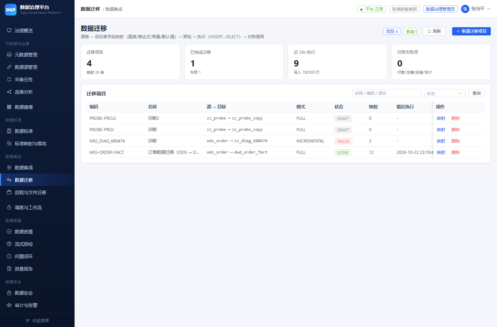

**完整步骤**：

1. 进入 **数据集成 → 数据迁移**，点击 **新建迁移项目**。

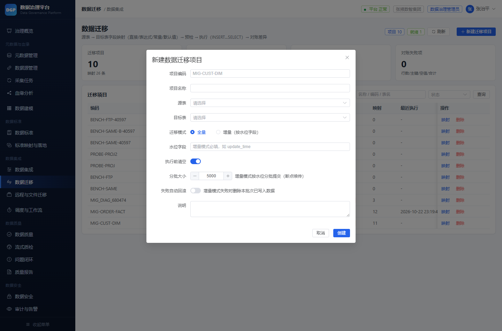

2. 填写编码、名称、**源数据源**（默认本库）、源表、**目标数据源**（默认本库）、目标表、模式（FULL/INCREMENTAL）、执行前是否清空目标表、分批大小、失败是否自动回滚。
3. 进入项目详情，切到 **字段映射**：
   - 点击 **自动推荐映射** 生成候选（显示匹配分与转换类型）；
   - 手工调整目标字段/转换类型/表达式；
   - 点击 **保存映射**（目标字段不可重复）。
4. 切到 **预检结果**：查看 `ready` 是否通过、错误/告警、样例数据、建议 DDL；目标表不存在时点 **一键建表**。
5. 切到 **执行与对账**：点击 **执行**（可指定是否替换/分批大小）。
6. 执行完成后点击 **对账**：查看 ROW_COUNT/PK_DUP/NULL_RATE/SUM 的期望值、实际值、结论；差异可在「差异明细」查看。
7. 需要撤回时点击批次行的 **回滚**（增量批次）；全量批次会提示不支持。

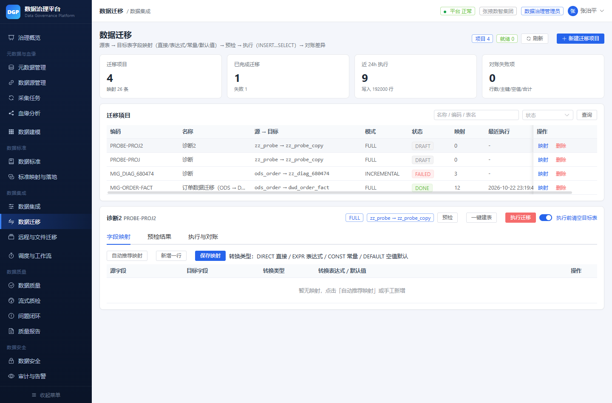

**转换类型示例**：

| 类型 | 说明 | 示例 |
|---|---|---|
| DIRECT | 源字段直接写入目标字段 | `customer_id → customer_id` |
| EXPR | SQL 表达式（函数/CASE） | `CONCAT('CK', customer_id)`、`CAST(amount AS DECIMAL(12,2))` |
| CONST | 固定常量 | `'DGP'` |
| DEFAULT | 源值为空时用默认值 | `COALESCE(phone, '未知')` |

### 13.3 跨网络数据库迁移（远程数据源 + 代理）

**适用场景**：旧系统库在新网段/机房，只允许经代理或跳板访问。

**步骤**：

1. 进入 **数据集成 → 远程与文件迁移 → 远程数据源（跨网络）**。

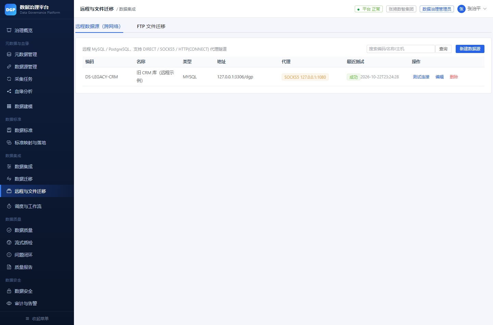

2. 点击 **新建数据源**，填写远端库信息（类型/主机/端口/库名/账号/口令）。
3. 选择 **代理类型**：
   - `DIRECT`：网络直通（专线/VPN 场景）；
   - `SOCKS5`：填代理主机/端口/账号/口令；
   - `HTTP CONNECT`：填企业正向代理地址与认证。
4. 点击 **测试连接**（未保存也可测试），成功会返回耗时与数据库版本。
5. 回到 **数据迁移 → 新建迁移项目**：源数据源选择该远程库，目标保持本库（或再选一个远程库实现远程↔远程）。
6. 自动推荐/预检/执行与同库迁移一致；执行时平台会「远程流式读 → 目标多行批量写」，内存平稳。

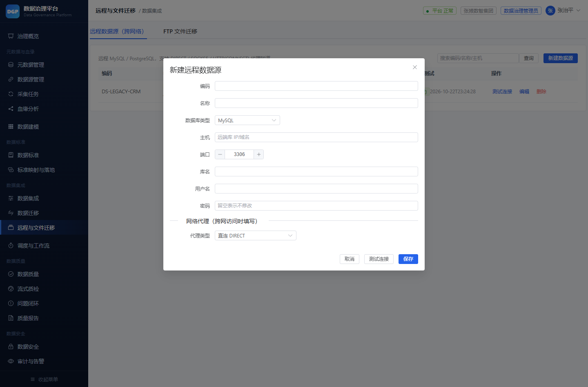

**注意事项**：

- 代理只影响平台发起的出站连接；平台自身数据库仍由部署环境变量配置。
- 远程口令 AES-GCM 加密存储，接口不回显；编辑时留空表示不修改。
- 跨库增量迁移需目标表包含映射后的水位字段，否则回滚会提示不支持。

### 13.4 FTP 文件迁移（CSV / TXT 摆渡）

**适用场景**：两侧网络互不可达，只能通过文件服务器（FTP）交换数据；或对方系统只提供文件接口。

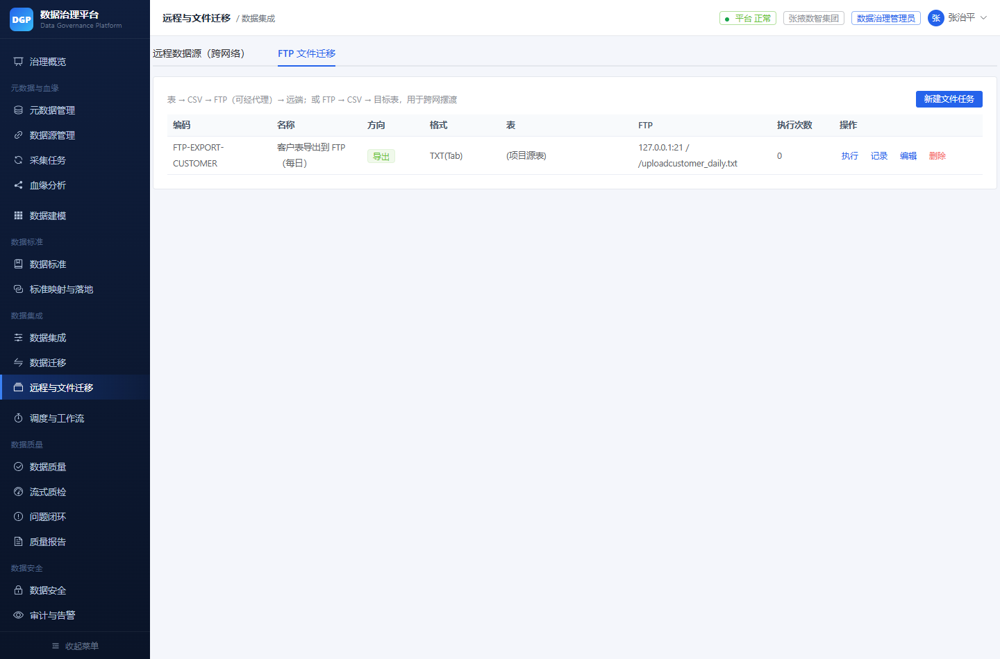

**导出（表 → 文件 → FTP）**：

1. 新建文件任务，方向选 **导出（表→FTP）**。
2. 选择迁移项目（复用其映射，决定列名与取数表达式）；也可直接指定源表。
3. 选择 **文件格式**：`CSV`（逗号）/ `TXT（制表符）` / `TXT（竖线 |）`。
4. 填写 FTP 主机/端口/账号/口令/远端目录/文件名；需要跨网时配置代理；可勾选 gzip 压缩。
5. 保存后点 **执行**；记录中查看行数、字节数、SHA-256 与耗时。

**导入（FTP → 文件 → 表）**：

1. 新建任务，方向选 **导入（FTP→表）**，目标表填（或在项目中定义）目标表。
2. 文件格式、FTP 参数、文件名与导出保持一致（导入会自动解压 gzip、按首行表头匹配列）。
3. 执行后查看导入行数；同项目的导出→导入行数应一致。

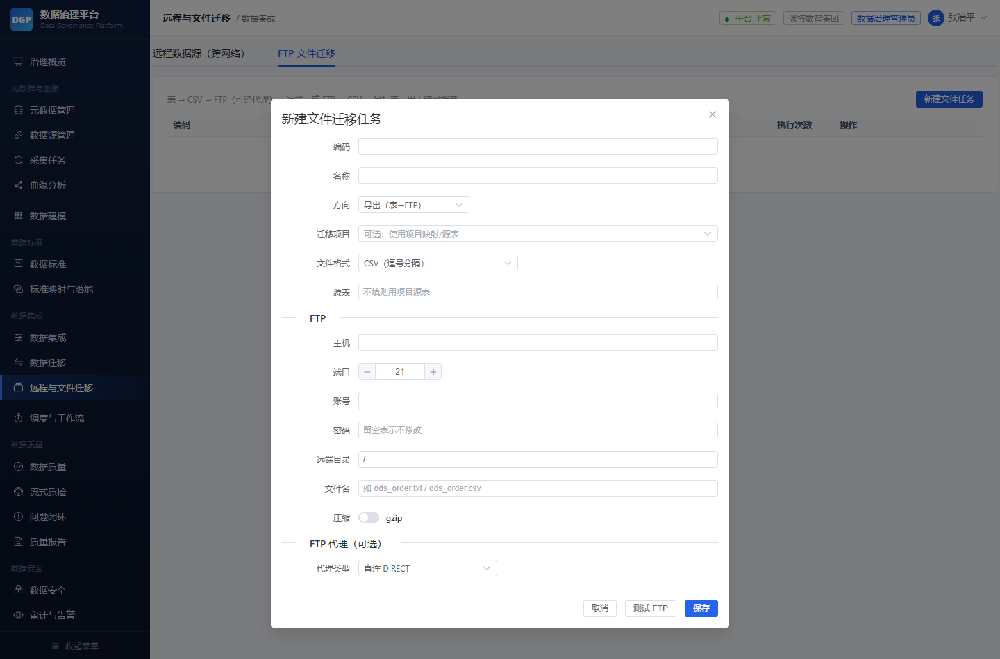

**TXT 格式约定**：

- 首行表头；字段用制表符（或 `|`）分隔；
- 字段内的 `\`、制表、换行分别转义为 `\\`、`\t`、`\n`；
- 空值写空串，导入时空串转 NULL（无损往返）。

### 13.5 分批执行、断点续传与回滚

| 能力 | 说明 | 操作 |
|---|---|---|
| 分批 | 增量模式按 `batchSize` 切水位窗口，每批提交并记录批次 | 项目配置或执行时传 batchSize |
| 断点续传 | 每批推进 `last_watermark`，中断后再次执行从水位继续 | 再次点「执行」即可 |
| 重新全量 | 重置水位后从起点重跑 | 需要时在项目中清空水位/换目标表 |
| 批次回滚 | 删除本批次起始水位之后的写入 | 批次行「回滚」 |
| 失败自动回滚 | 项目开启后异常自动删除本批写入 | 项目配置 `失败自动回滚`=开 |

### 13.6 大数据量与性能建议

| 数据量 | 建议 | 实测参考（4C8G，单 jar，-Xmx2g） |
|---|---|---|
| ≤100 万行 | 全量迁移，默认参数 | 同库 <10s；跨库约 15s；FTP 约 15s |
| 100 万～1000 万 | 全量或增量分批（batchSize 2000～5000） | 同库 19 万行/s；跨库 8～9 万行/s |
| 1000 万～1 亿 | 增量 + 水位分批，避开业务高峰 | 小时级；内存平稳（约 880MB） |
| >1 亿 | 增量分批、目标表导入期去二级索引、分区表 | 夜间窗口滚动 |

**调优**：并发迁移多或单批 >2000 万行时把 `-Xmx` 调到 4g；跨网时带宽是首要瓶颈，可先 gzip 走 FTP；目标表导入期删除二级索引，完成后重建可再快 1.5～3 倍。

详见 [大数据量迁移基准.md](大数据量迁移基准.md)。

### 13.7 常见错误与排查

| 现象 | 原因 | 处理 |
|---|---|---|
| 创建项目提示「表不存在或不可读」 | 源表物理不存在，或当前账号无权限 | 确认表名/库；用「远程数据源-测试连接」或本地 `SELECT` 验证 |
| 预检 `ready=false` | 映射为空、源字段不存在、目标缺列 | 按错误/告警修正映射；先「一键建表」 |
| 执行报主键冲突 | 目标表已有同主键数据且未清空 | 开启「执行前清空目标表」，或改用增量模式 |
| 回滚返回 400 | 全量批次无起始水位，或映射缺水位字段 | 全量批次不支持回滚；增量请把水位字段加入映射 |
| FTP 连接失败 | 地址/端口/口令错误、被动模式端口未放通、代理未认证 | 先用「测试 FTP」；检查 21 端口与被动端口段（如 30000-30010） |
| FTP 上传/下载失败 | 远端目录不存在或无写权限 | 任务会自动建多级目录；无权限请让 FTP 管理员授权 |
| 跨库连接超时 | 代理不可达、库端口未放通、防火墙 | 用「测试连接」定位；确认代理账号口令 |
| TXT 导入列不匹配 | 表头与目标列名不一致 | 用同一项目导出，或手工把表头改成目标列名 |

---

## 14. 系统管理

### 14.1 平台健康 / 服务清单 / 运行参数

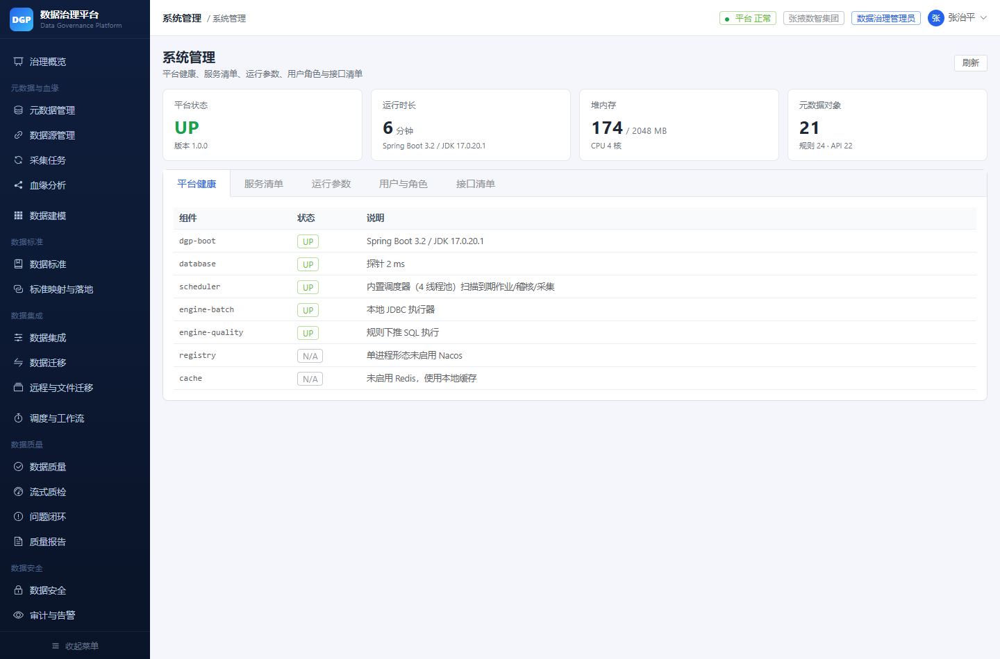

- **平台健康**：数据库、缓存、调度、存储等组件的探针状态与延迟；异常项标红。
- **服务清单**：各内部服务的健康检查结果、响应耗时、最近检查时间；支持手动刷新。
- **运行参数**：以 Key-Value 维护系统参数（如质量评分权重、限流阈值、采集频率）；修改即时生效（部分需重启，页面有标注）。

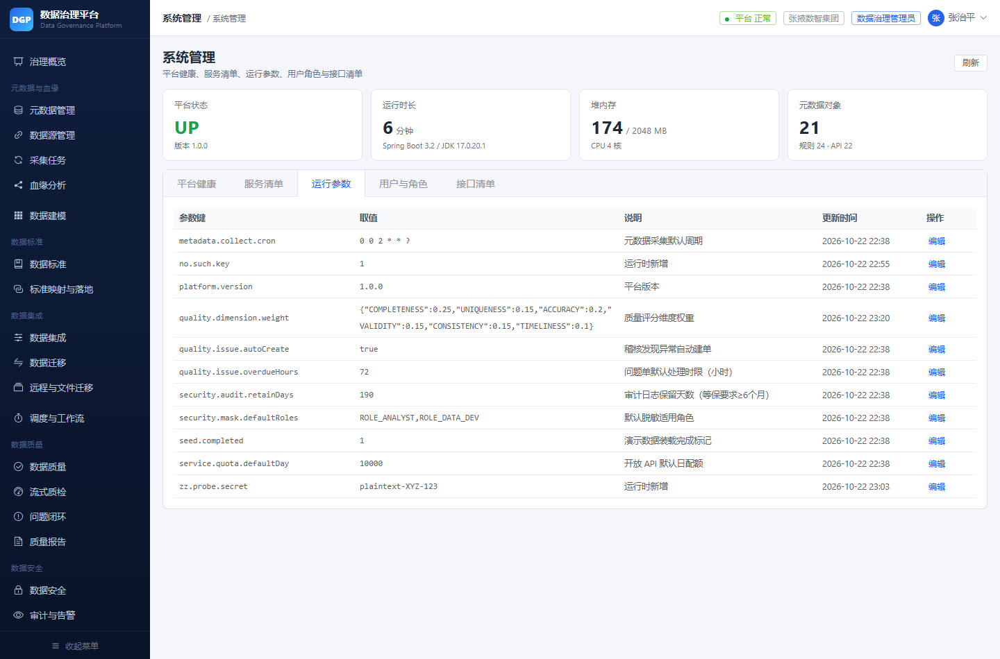

### 14.2 用户与角色

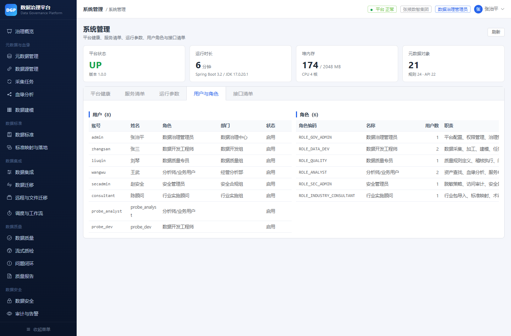

**用户管理**：

1. 新建用户：账号、姓名、初始口令、角色、部门、邮箱/手机。
2. 分配角色：一个用户一个主角色；特殊权限可通过角色授权调整。
3. 停用/重置口令/删除：删除前请确认无在用任务；管理员不可删除自己。

**角色权限**：

1. 选择角色 → 勾选模块权限点（如 `migration:project:exec`）。
2. 保存后对已登录用户生效（重新登录或 30 秒内缓存过期）。
3. 角色权限变更会记入审计日志。

**数据范围**：可为角色配置数据范围（全部/本部门/本人），影响问题单、资产等列表可见范围。

### 14.3 字典、接口清单与审计

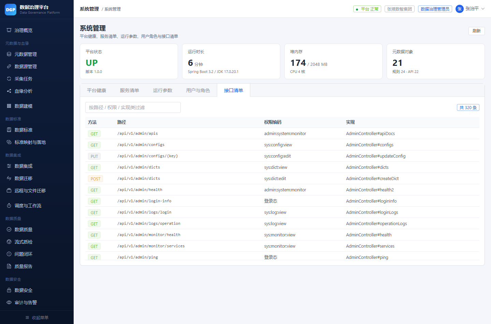

- **接口清单**：列出全部 REST 接口（方法、路径、所需权限、处理方法），可按关键字筛选，便于对接与排障。
- **字典管理**：维护 `质量维度`、`问题状态`、`敏感等级`、`行业编码`、`数据分层`、`任务状态` 等枚举；字典项修改后前端下拉即时更新。
- **审计日志**：见 9.2。

### 14.4 监控与限流

- 监控页展示 JVM/数据库连接池/接口 QPS 等指标。
- 登录接口有失败限流（默认窗口内多次失败会返回 429），防止暴力破解。
- 概览类接口内置 5 秒缓存与写操作失效，保障高并发下的看板性能。

---

## 15. 运维与部署

### 15.1 部署形态

- 后端：Spring Boot 单 jar（`dgp-boot.jar`），默认端口 8092；前端静态资源打包在 jar 内。
- 反向代理：Nginx 监听 8093，转发 `/api` 到 8092，静态资源直出（开启 gzip、缓存）。
- 数据库：MySQL 8（生产）/ H2（演示）；Schema 与演示数据随启动自动初始化（`CREATE TABLE IF NOT EXISTS`，不会覆盖已有数据）。

### 15.2 关键环境变量

| 变量 | 说明 | 示例 |
|---|---|---|
| `DGP_DB_URL` / `DGP_DB_USER` / `DGP_DB_PASSWORD` | 主数据库连接 | `jdbc:mysql://127.0.0.1:3306/dgp` |
| `DGP_MASK_KEY` | 脱敏与口令加密密钥（任意长度，内部 SHA-256 派生） | 随机长串 |
| `SERVER_PORT` / `SERVER_TOMCAT_THREADS_MAX` | 服务端口 / 最大线程 | `8092` / `500` |
| `JAVA_OPTS` | JVM 参数 | `-Xms1g -Xmx2g -XX:+UseG1GC` |
| `DGP_LOG_DIR` | 日志目录 | `/opt/datagov/logs` |

### 15.3 启停与健康检查

```bash
systemctl status datagov        # 服务状态
systemctl restart datagov       # 重启（会重置进程内登录限流计数）
curl -s http://127.0.0.1:8092/api/v1/admin/ping   # 健康检查
tail -f /opt/datagov/logs/app.log                  # 应用日志
tail -f /opt/datagov/logs/app.err.log              # 错误日志
```

Nginx 配置校验与重载：`nginx -t && systemctl reload nginx`。

### 15.4 升级与数据库变更

1. 备份数据库：`mysqldump -u root -p dgp > dgp_$(date +%F).sql`。
2. 停止服务，替换 jar，按版本执行升级 SQL（如 `sql/upgrade-v1.3-to-v1.4.sql`）。
3. 启动服务，检查健康与首页；执行验收脚本（`verify/` 目录）确认核心链路正常。
4. 升级前请阅读仓库 `docs/` 中对应版本文档的「升级说明」。

### 15.5 备份与日志

- 建议每日全备 + binlog 增量；备份文件异地存放。
- 日志按天滚动，保留 30 天；审计日志单独归档（合规要求）。
- 磁盘水位监控：日志/备份目录超过 80% 需清理。

### 15.6 大数据量注意事项

- 迁移/导入属于重 IO 操作，建议业务低峰执行；可通过「增量 + 分批」降低峰值。
- 单 jar 的 Web 与迁移共享 JVM 堆，内存调优见 13.6。
- 长事务/大 SQL 请开启慢查询日志，便于定位。

---

## 16. 典型场景演练

### 场景 1：新业务库接入并完成治理闭环（约 15 分钟）

1. 数据源管理 → 新建数据源 → 测试连接 → 采集元数据。
2. 元数据管理 → 确认新表已登记 → 补充中文名/负责人/域。
3. 数据标准 → 把关键字段映射到企业标准 → 查看落标率。
4. 数据质量 → 为新表建 3~5 条规则 → 试跑 → 加入稽核任务。
5. 稽核执行 → 问题单自动生成 → 派单处理 → 关闭。
6. 资产 → 确认资产价值分与质量分 → 资产地图查看位置。
7. 数据服务 → 发布 1 个查询 API → 调试 → 授权给业务系统。

### 场景 2：旧 CRM 库跨网迁移到新平台

1. 远程与文件迁移 → 新建远程数据源（旧库地址 + SOCKS5 代理）→ 测试连接。
2. 数据迁移 → 新建迁移项目：源=远程旧库，目标=本库 DWD 表，模式 FULL。
3. 自动推荐映射 → 修正类型不一致字段（EXPR/CAST）→ 保存。
4. 预检 → 一键建表（或先 DDL）→ 执行。
5. 对账 → 行数/主键/合计一致 → 记录结果。
6. 若需回滚：批次行「回滚」；若数据量大改为 INCREMENTAL + 分批。

### 场景 3：Kafka 流数据实时质检

1. 流式质检 → 新建流源（贴源表 + 水位字段 + 窗口 60s）→ 配置主键字段。
2. 推送接入 → 配置字段映射 JSON → 保存 → 用「模拟推送」验证。
3. Kafka 消费者把消息逐条 POST `/api/v1/quality/stream/push/{code}`。
4. 观察实时 KPI/告警；对告警处置并关联问题单。
5. 若消息中断，检查消费者日志与网络；平台侧无需额外组件（HTTP 入口）。

### 场景 4：跨网文件摆渡（FTP）

1. 远程与文件迁移 → FTP 文件迁移 → 新建导出任务（项目 + TXT 制表符 + gzip）。
2. 执行导出 → 记录 SHA-256 → 通知对端取文件。
3. 对端导入：新建导入任务（相同格式/文件名）→ 执行 → 比对行数。
4. 定期执行可将任务写入调度（当前通过工作流触发或外部调度调用执行接口）。

### 场景 5：质量问题闭环与报告

1. 质量报告 → 生成月报 → 下载 HTML/Markdown。
2. 问题闭环 → 筛选超期问题 → 逐条处理并复核。
3. 概览 → 确认综合质量分与闭环率提升。
4. 审计 → 核对处理动作留痕。

---

## 17. 常见问题（FAQ）

**Q1：登录返回 429？**
A：登录失败限流触发，等待 1~5 分钟后重试；确认账号未被锁定。运维可重启服务立即重置计数。

**Q2：菜单比同事少？**
A：菜单按角色权限下发，请在系统管理 → 用户与角色中检查权限点。

**Q3：采集后看不到新表？**
A：确认采集实例成功、数据源指向正确库；`md_table` 中已有同名表时以元数据详情为准。

**Q4：质量规则试跑通过但稽核失败？**
A：试跑可能有抽样与时间范围差异；确认稽核任务的抽样比例、时间窗口与规则阈值。

**Q5：流式质检没有结果？**
A：检查流源是否启用、水位字段是否推进、规则是否启用；首次可「重置水位 + 执行全部窗口」。

**Q6：推送接入报「字段映射为空」？**
A：确认推送配置已保存且报文键名与映射一致，且流源配置了主键字段 `pk_col`。

**Q7：迁移执行后目标行数少于源？**
A：检查映射是否过滤（EXPR/DEFAULT）、目标表是否有唯一约束冲突；增量模式未重置水位也会只迁增量。

**Q8：回滚为什么 400？**
A：仅增量批次支持回滚，且映射需包含水位字段；全量批次无起始水位，不支持回滚。

**Q9：跨库迁移很慢？**
A：网络带宽、代理延迟、目标表索引都会影响；用增量分批、目标表导入期去索引、避开高峰。

**Q10：大数据量会不会 OOM？**
A：v1.4.2 起取数为流式（游标/逐行），5M 行实测内存平稳约 880MB；并发多个迁移或超大单批请调大 `-Xmx`。

**Q11：FTP 被动模式连不上？**
A：放通被动端口段（默认 30000-30010）；云主机需在安全组放通；可改为主动模式（需网络允许）。

**Q12：TXT 里中文乱码？**
A：平台按 UTF-8 读写；若对端要求 GBK，请先在文件服务器转换编码后再导入（或反馈需求）。

**Q13：接口报 403？**
A：当前账号缺权限点，请管理员在角色中授权；临时排查可用「接口清单」查看所需权限。

**Q14：报告导出失败？**
A：检查磁盘空间与报告服务状态；大报告建议缩小范围或分页生成。

**Q15：服务调用 401/超时？**
A：AK/SK 是否正确、API 是否发布、配额是否用尽；超时请查下游库负载。

**Q16：部署后首页空白？**
A：强刷（Ctrl+F5）清缓存；检查 Nginx 指向的静态目录与 jar 内 static 是否一致。

**Q17：如何彻底重置演示数据？**
A：停服务 → 删库重建（或删除数据文件）→ 启动，平台会自动建表并装载演示数据。

**Q18：审计日志能改吗？**
A：不能，审计为追加写；如需归档请导出后离线保存。

---

## 附录 A 角色与权限点

| 权限点 | 说明 | 默认角色 |
|---|---|---|
| `metadata:table:view/edit` | 元数据查看/编辑 | 管理员、开发、质量、分析师、顾问 |
| `metadata:datasource:*` | 数据源管理 | 管理员、开发 |
| `metadata:collect:exec` | 执行采集 | 管理员、开发 |
| `model:entity:*` | 建模 | 管理员、开发 |
| `standard:*` | 标准与映射 | 管理员、开发、顾问 |
| `integration:job:*` | 集成作业 | 管理员、开发 |
| `workflow:*` | 调度与工作流 | 管理员、开发 |
| `quality:rule:* / quality:check:* / quality:issue:*` | 质量规则/稽核/问题 | 管理员、开发、质量 |
| `quality:stream:view/create/edit/exec/handle` | 流式质检 | 管理员、开发、质量（分析师只读） |
| `quality:report:*` | 质量报告 | 管理员、质量、分析师 |
| `security:*` | 安全策略/审计 | 管理员、安全管理员 |
| `asset:*` | 资产与地图 | 管理员、开发、分析师 |
| `service:api:*` | 数据服务 | 管理员、开发 |
| `migration:project:view/create/edit/exec/reconcile` | 数据迁移 | 管理员、开发、顾问 |
| `migration:ds:view/edit/test` | 远程数据源 | 管理员、开发、顾问 |
| `migration:file:view/edit/exec` | FTP 文件迁移 | 管理员、开发、顾问 |
| `industry:package:*` | 行业包 | 管理员、顾问 |
| `sys:user/role/perm/config/dict/monitor:*` | 系统管理 | 管理员（安全管理员只读） |

> 完整权限点以「系统管理 → 接口清单」与 `docs/API清单.md` 为准（接口 ↔ 所需权限一一对应）。

---

## 附录 B 验收、性能与文档索引

### B.1 验收规模

| 套件 | 断言数 | 结果 |
|---|---|---|
| 冒烟 + 核心链路 + 扩展链路 + 剩余链路 | 73 + 70 + 70 + 81 | 全部通过 |
| 流式质检 + 数据迁移（推送/分批/回滚） | 55 | 全部通过 |
| FTP 文件迁移 + 跨网络迁移（含代理、TXT） | 29 | 全部通过 |
| **合计** | **378 项** | **0 失败** |

### B.2 性能参考（4C8G，单 jar）

| 指标 | 结果 |
|---|---|
| 登录 | 约 10 次/秒 |
| 治理概览（c=200） | 11,322 QPS（5s 缓存） |
| 元数据/资产/迁移列表 | 1.4k～19k QPS 视接口而定 |
| 同库迁移（500 万行） | 19.2 万行/s，峰值内存 375MB |
| 跨库迁移（500 万行） | 8.9 万行/s，峰值内存 878MB（流式） |
| FTP 导入（500 万行） | 10.1 万行/s |

### B.3 文档索引

| 文档 | 说明 |
|---|---|
| [README](../README.md) | 项目总览、快速启动、目录结构 |
| [API清单](API清单.md) | 全部 REST 接口（方法/路径/权限，320 个） |
| [验收报告-全功能验证](验收报告-全功能验证.md) | 378 项断言明细 |
| [功能-流式质检与数据迁移](功能-流式质检与数据迁移.md) | 流式质检/同库迁移详细设计 |
| [功能-FTP与跨网迁移](功能-FTP与跨网迁移.md) | 远程数据源/代理/FTP 详解 |
| [大数据量迁移基准](大数据量迁移基准.md) | 100 万～500 万行实测与调优 |
| [开发与运维手册](开发与运维手册.md) | 模块、库表、配置、排障 |
| [压测报告-4C8G](压测报告-4C8G.md) | 各接口压测数据 |
| [VM测试部署清单](VM测试部署清单.md) | 4C8G 虚拟机部署步骤 |

---

## 附录 C 版本历史

| 版本 | 内容 |
|---|---|
| v1.0 | 元数据/建模/标准/集成/质量/安全/资产/服务/行业/系统管理全链路 |
| v1.2 | 流式（微批）数据质检、数据迁移映射（推荐/预检/执行/对账） |
| v1.3 | 流式实时推送接入、迁移分批/断点续传/回滚/一键建表、概览性能优化 |
| v1.4 | 远程数据源 + SOCKS5/HTTP 代理隧道、跨网络库迁移、FTP 文件迁移（CSV/TXT） |
| v1.4.2 | 大数据量优化（游标流式读 + 多行批量写）、500 万行基准、操作手册 |

> 如需新增功能章节或补充贵司特有的操作流程（账号/网络/合规要求），可在本手册基础上扩展。
